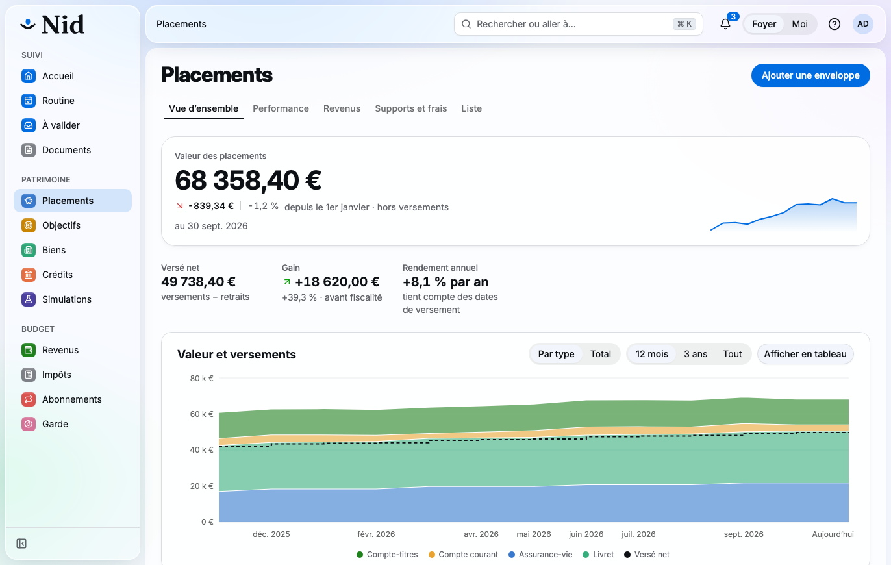

# Nid

**A self-hosted overview of a household's finances: what you own, what is committed every month, what earns and what
costs, and how it all moves over time.**

[](https://github.com/Mistribe/Nid/actions/workflows/ci.yml)
[](LICENSE)

<picture>
  <source media="(prefers-color-scheme: dark)" srcset="docs/frontend/screens/overview-dark.png">
  
</picture>

Nid is not a budgeting or bookkeeping tool: day-to-day transactions stay in your banking app. It answers the questions
those apps leave open:

- **Where do we stand?** Net worth, by envelope and by owner (mine, yours, joint).
- **What is committed each month?** Subscriptions, loans, insurance, childcare, and what is coming up next.
- **What earns, what does not?** Gain and annual return of each investment, before and after fees.
- **How does our loan work?** Interest and principal in each payment, balance left, total cost, early repayment.
- **What is left each month?** Income, committed share, and the margin before everyday spending.

It is built for **two adults sharing one household**, with children as dependents. Every item has owners and is either
shared or private. A monthly routine of a few minutes keeps it current, instead of daily data entry.

> [!NOTE]
> Nid is built for one French household and is used every day. The interface is **in French only**, and the tax,
> savings and childcare rules are **French** (income tax, PEA, PER, Livret A, Pajemploi). The API and data model change
> without notice between versions.

## Features

| Area | What Nid does |
|---|---|
| Dashboard | Net worth and its trend, monthly income, commitments and what is left, what changed this month, what is coming up |
| Subscriptions | Free trials, launch prices, prepaid terms, gift cards and bundles; amortized monthly and yearly cost; any currency, converted at ECB rates; a provider catalog with icons |
| Investments | Envelopes (PEA, life insurance, PER, savings accounts, brokerage), valuations and flows, holdings and switches, money-weighted annual return, fees and their cost over 10 and 20 years, regulated savings ceilings |
| Property and loans | Properties and their net value, a loan schedule engine checked against 3,000 reference loans, the bank's schedule side by side, early repayment and renegotiation simulations, rentals with rent revisions and receipts |
| Income | Salaries and their phases, payslips, one-off income, withholding rate against the estimated real rate |
| Tax | An estimate of French income tax for the household, the tax notices, and what-if simulations |
| Childcare | A childminder's contract, monthly statements ready for Pajemploi, paid leave and the childcare tax credit |
| Planning | Savings goals, a net worth projection, and what-if scenarios such as buying a property |
| Documents | Files linked to the items they concern |
| Bank sync | Balances and transactions through Enable Banking, or OFX and CAMT.053 statement files |
| Assistant | An MCP server (`/mcp`) with read tools and write tools that only **propose**: every change from an assistant waits in « À valider » until a person approves it |

A few rules hold everywhere:

- **Amounts are computed by the server, deterministically.** An AI assistant may read and propose; it never computes a
  gain, a return, a schedule or a tax.
- **Every figure keeps its source**: entered by hand, imported, read from a bank, or proposed from a document.
- **Your data stays yours**: self-hosted, a full export and import in one JSON file (`nid.data`), nightly encrypted
  backups in the reference setup, and an audit log of every change and of security events.

## Self-hosting

You need Docker with Compose v2, two host names (for example `nid.example.org` and `auth.example.org`), a reverse
proxy that terminates TLS, and a device able to create a **passkey**: sign-in goes through
[Pocket ID](https://github.com/pocket-id/pocket-id), which only accepts passkeys.

There is no public image yet: build it from this repository.

```bash
docker build -f src/Nid.Host/Dockerfile -t nid:local .
```

Then pick one of the two setups:

- **Standalone** ([`deploy/standalone/`](deploy/standalone/compose.yaml)): one Compose file and one `.env`, nothing to
  run first. Postgres and Pocket ID are optional profiles, for when you already run them elsewhere. Set
  `NID_IMAGE=nid:local` in `.env`.

  ```bash
  cd deploy/standalone
  cp .env.example .env    # then fill it in, with NID_IMAGE=nid:local
  docker compose --profile postgres --profile pocket-id up -d
  ```

- **Reference** ([`deploy/`](deploy/README.md)): Postgres, Pocket ID, Nid and an encrypted `restic` backup to a local and
  an optional remote repository, with `deploy/setup.sh` to generate the secrets and `deploy/restore.sh` to restore.

[`deploy/README.md`](deploy/README.md) covers the installation, updates, backups and bank sync in detail (in French).
The first person to sign in becomes the administrator and admits the other adults.

## Development

Requirements: the .NET 10 SDK (see [`global.json`](global.json)), the [Aspire CLI](https://aspire.dev), Docker, and
Node 24 or later with pnpm (`corepack enable`).

```bash
aspire run                               # Postgres, Pocket ID, the API, the Vite front end, a TLS proxy and the Aspire dashboard
pnpm --dir web install                   # front-end dependencies, exact versions from the lockfile
pnpm --dir web check                     # types, lint, tests, build and the bundle budget
pnpm --dir web e2e                       # Playwright journeys, signed in through Pocket ID's API
dotnet test --solution Nid.slnx --configuration Release --max-parallel-test-modules 1   # unit and integration tests (Docker required)
dotnet test --project tests/Nid.RealEstate.IntegrationTests                            # one module's integration tests
```

The app runs at `https://nid.localtest.me`, Pocket ID at `https://auth.localtest.me`, and the Aspire dashboard (logs,
traces, metrics) at the URL `aspire run` prints. On first start, a one-off `pocket-id-bootstrap` process creates the
`nid-users` and `nid-admins` groups, three development users (`alice`, administrator; `bob`; `carol`, without access)
and Nid's OIDC client. To start again from an empty database: `docker volume rm nid-dev-pgdata nid-dev-pocket-id`.

**Demo data.** [`deploy/local/demo/`](deploy/local/demo) fills every screen with an invented household (Alice, Bob and
Léa): subscriptions, bank accounts, investments, three properties and three loans, income, childcare, goals, tax
notices, scenarios and documents, dated up to last month. With the stack running and Playwright installed:

```bash
node deploy/local/demo/load.mjs                 # signs in as Bob, then Alice, and loads everything through the API
node deploy/local/demo/sign-in-link.mjs alice   # a one-time sign-in link (the demo users have no passkey)
```

**API client.** `dotnet build` rewrites [`web/src/api/openapi.json`](web/src/api/openapi.json); run
`pnpm --dir web gen:api` to regenerate `web/src/api/schema.d.ts`, and commit both (CI checks them with
`pnpm --dir web check:api`).

## How it is built

| Layer | Choice |
|---|---|
| Back end | .NET 10, ASP.NET Core minimal APIs, EF Core with Npgsql, NodaTime, Quartz.NET, [Synapse](https://github.com/UnambitiousFx/Synapse) for commands, queries and events |
| Database | PostgreSQL, one schema per module |
| Front end | React, TypeScript, Vite, Tailwind CSS and shadcn/ui, TanStack Query, a client generated from the OpenAPI document; installable as a PWA |
| Identity | Pocket ID (OIDC, passkeys); the browser talks to a backend-for-frontend with a session cookie |
| Assistant | The MCP C# SDK, on personal access tokens with scoped presets |

Nid is a modular monolith: one process serves the web app, the API, the MCP endpoint and the scheduled jobs.

```
src/       Nid.<Module>.{Domain,Application,Contracts,Infrastructure} for each module (Subscriptions, Investments,
           RealEstate, Income, Childcare, Goals, Documents, Banking), Nid.Core for what they share (people, items,
           ownership, tax, dashboard, proposals), Nid.Platform, Nid.Host (the single executable) and Nid.AppHost (Aspire)
web/       the React app
tests/     unit and integration tests per module, and shared test vectors
deploy/    the Compose setups, backups, and the demo household
docs/      the design documents (in French): Project.md, architecture.md, the data models, roadmap.md
```

## Contributing

Issues and pull requests are welcome, in English. [CONTRIBUTING.md](CONTRIBUTING.md) explains the templates, branch
names, the tests to run before opening a pull request (CI does not run them), the changelog and how the version is
set. Never paste real financial data, yours or anyone's: describe the shape of a problem with invented figures.

## Security

Do not report a vulnerability in a public issue: see [SECURITY.md](SECURITY.md) to report it privately.

## License

[MIT](LICENSE) © 2026 Mistribe
