# Écrans et navigation

> Statut : direction visuelle décidée (refonte 2026-10-18, `../superpowers/specs/2026-10-18-ui-redesign-design.md`), identité visuelle du 2026-11-03 (`../superpowers/specs/2026-11-03-visual-identity-design.md`, captures au §13). Carte des écrans, routine mensuelle, boîte de validation, assistants d'import et d'export, états et erreurs.
> Références : `README.md`, `design-system.md`, `dataviz.md`, `../Project.md` §5 à §8, `../import-format.md` §10 et §11.

---

## 1. Navigation

- **Mobile** : barre d'onglets en bas : Accueil, Placements, Abonnements, Routine, Plus. « Plus » liste À valider (avec son badge), Biens, Crédits, Revenus, Import, Export, Sécurité, Réglages et, pour un admin, Administration ; la déconnexion y est aussi ; l'onglet « Plus » est marqué courant sur ces pages. Source : `web/src/components/nav.ts`.
- **Bureau** : barre latérale en trois groupes : **Suivi** (Accueil, Routine, À valider), **Patrimoine** (Placements, Biens, Crédits), **Budget** (Revenus, Abonnements). Badges sur « Routine » (nombre de tâches du tableau de bord) et « À valider ». Le **menu de la personne** termine la barre du haut, après le sélecteur Foyer / Moi, la cloche et le guide, sur bureau comme sur téléphone : un disque à ses initiales (son nom accessible est celui de la personne) ouvre son nom, Import, Export, Sécurité, Réglages, Administration (admin), Se déconnecter, puis la version (celle de l'API à côté, un clic ouvre « Nouveautés »). La barre latérale ne porte que les modules et, à son pied, le bouton qui la replie ; sur téléphone, « Plus » liste aussi les pages du compte. La barre se replie en rail d'icônes (bouton au pied de la barre, en bas à gauche dans les deux états, Ctrl B / ⌘ B), d'office entre 768 et 1 280 px tant que la personne n'a pas choisi (`design-system.md` §6.1).
- **Nouveautés** (`/changelog`, `app/ChangelogPage.tsx`) : ouverte par la version du menu de la personne, la ligne « Nouveautés » de « Plus » et le lien de Administration › Système. En-tête, puis les versions de l'application et de l'API en `StatLine`. Les versions, de la plus récente à la plus ancienne, groupées par version mineure : la `x.y.0` en tête du groupe (titre, date longue, ses changements en lignes simples), ses correctifs dessous, plus serrés, dans un filet. La version en service porte « Version actuelle ». Les trois groupes les plus récents sont ouverts, les autres repliés sous « Versions précédentes ». Chaque version a son ancre (`/changelog#0.12.0`, le numéro est un lien vers elle) ; une ancre vers un groupe replié l'ouvre. Chargement, erreur et « Aucune nouveauté à afficher. » (un serveur de dev n'a pas de `public/changelog.json`) ; un changement sans ligne dans la langue de l'application se lit en français.
- **Administration** n'apparaît (menu de la personne, et page « Plus » sur mobile) que si `capabilities.admin`. Un non-admin qui saisit une URL `/admin/*` voit la page « accès refusé » ; le serveur refuse de toute façon (`../identity-and-access/authorization.md` §6).
- Un module désactivé côté backend disparaît (`capabilities`, `architecture.md` §2).
- **Sélecteur Foyer / Moi** dans l'en-tête, conservé dans l'URL (`?scope=`). Il correspond à `IVisibleItems` : `Household` (éléments partagés) ou `Me` (partagés et mes privés). Défaut : Foyer. Le choix Foyer / Moi est conservé par tous les liens internes et par « Retour » (2D2a).
- **Guides** : chaque module a un guide d’introduction (« Accueil : premiers pas », « Abonnements : premiers pas », etc.), une boîte de dialogue qui se joue d’elle-même à la première visite du module, avec « Passer » ; le bouton « Guide de cette page » (« ? », dans l’en-tête) le rejoue à tout moment. Sur quatre pages (Accueil, une enveloppe, un crédit, la routine), l’introduction se prolonge par une visite à l’écran (« Me montrer à l’écran ») qui désigne les éléments de la page ; tout changement de route y met fin. Le « déjà vu » est gardé par adulte sur le serveur (préférence `guidesSeen`, un numéro de version par guide) : un guide vu ne se rejoue pas sur un autre appareil, et un guide dont le texte change de version se rejoue une fois. Spécification : `../superpowers/specs/2026-10-16-module-guides-design.md`.

## 2. Écrans

| Écran | Contenu |
|---|---|
| **Tableau de bord** | Voir §3 |
| **Abonnements** | Voir §4 |
| **Placements** | Enveloppes avec valeur, gain en € et en % **avec la mention « avant fiscalité »**, date de dernière valeur (signalée si périmée). Détail : courbe valeur contre versements nets, tableau des valorisations et flux, saisie rapide d'une valeur ; gain depuis la dernière valeur, performance d'une période. Modèle : `../investments-data-model.md`. **Livré en 2B2a** (2026-09-29) : liste (valeur, date, gain en € et en %, péremption), création avec versements antérieurs et première valeur, détail (chiffres, avertissement de versements antérieurs manquants, tableaux des valeurs et des flux), saisie, correction et suppression. **Livré en 2B2b** (2026-09-30) : courbe valeur contre versements nets avec sa vue en tableau, virements entre enveloppes, clôture et réouverture (et les clôturées dans la liste sur demande), performance d’une période, réglages. **Prévu** : onglets « Vue d’ensemble », « Performance », « Supports et frais » et « Liste » ; vue d’ensemble du foyer (valeur, versé, gain et rendement annuel, valeur par type et versements, répartition, part de chacun, à surveiller) ; performance d’une période (d’où vient la variation, mois par mois, ce qui a rapporté, rendement annuel comparé aux livrets) ; supports réunis entre enveloppes (exposition par type, concentration, frais estimés) (`../superpowers/specs/2026-10-22-investments-dashboard-design.md`). **Livré (tableau de bord des placements, PR 1)** (§3) : onglets « Vue d’ensemble » (ouvert d’abord) et « Liste » (`?tab=list`, la liste d’avant avec son interrupteur des enveloppes clôturées) ; chiffres du foyer : valeur des placements avec sa date la plus ancienne, les valeurs à mettre à jour et les enveloppes sans valeur, versé net, gain signé « avant fiscalité » et son pourcentage, rendement annuel ou « Non significatif », depuis le 1er janvier hors versements ; « Valeur et versements » en aires empilées par type d’enveloppe (couleur fixe par type) ou en total, versé net en pointillé, « 12 mois / 3 ans / Tout » dans `?curve=`, « Afficher en tableau » ; « Répartition par type » (barre et tableau), « Part de chacun » (ton neutre, part et gain), « À surveiller » (valeur à mettre à jour, aucune valeur, versements antérieurs manquants, échéance d’un support, part en unités de compte sous le plancher ; chacun vers sa fiche, l’onglet Supports pour un support) ; « Enveloppes » (type, propriétaires, valeur, gain, rendement annuel, dernière valeur, total ; une autre devise montre le converti en infobulle) ; « Inconnu » et la devise quand un taux manque ; « Aucune enveloppe ouverte » mène aux clôturées. **Livré (PR 2)** (§4) : onglet « Performance » (`?tab=performance`, entre la vue d’ensemble et la liste) — période « Cette année » (le défaut, absent de l’adresse), « 12 mois », « 3 ans », « Tout » (depuis la plus ancienne valeur) ou « Autre période… » (deux dates dans une boîte de dialogue, vérifiées avant l’envoi), gardée dans `?from=&to=` ; chiffres : performance de la période signée, rapportée aux sommes engagées, meilleur et pire mois ; les enveloppes qui ne comptent pas, nommées avec leur raison ; « D’où vient la variation de valeur » (valeur de départ, versements, retraits, virements avec d’autres enveloppes s’il y en a, performance, valeur d’arrivée, en barres de part et d’autre d’un axe) ; « Performance mois par mois » en barres signées avec sa vue en tableau ; « Ce qui a rapporté » (une ligne par enveloppe vers sa fiche) et « Rendement annuel depuis l’ouverture » (un point par enveloppe, vos livrets en trait pointillé, les non significatifs nommés). **Livré (PR 3)** (§5) : onglet « Supports et frais » (`?tab=holdings`, avant « Liste », présent seulement quand une enveloppe a un relevé) — chiffres : détaillé par support (enveloppes détaillées, part de la valeur), part en unités de compte (assurance-vie et PER, avec le plancher quand il n’y en a qu’un), frais estimés de l’année précédente « estimation », prochaine échéance ; une note par support détenu dans plusieurs enveloppes (« … pèse … du foyer ») ; « Exposition par type de support » (barre et tableau, puis ce qui est hors détail : enveloppes sans relevé et non-réparti) ; « Supports » (support, enveloppe, valeur, poids, gain %, rendement annuel, frais totaux ; « Par support / Par enveloppe » ; une ligne ouvre la fiche du support) ; « Ce que coûtent les frais » (≈ coût par support, la règle de l’estimation, les supports sans rapport comptés) ; « À surveiller » (échéance, parts inexpliquées, plancher UC, parts × prix différents de la valeur ; chacun vers son support ou l’onglet Supports de l’enveloppe). **Livré (issue #103)** : dans « Ce que coûtent les frais », la part de chaque support dans les frais du foyer et les supports sans rapport nommés ; « Frais par enveloppe » (frais du contrat, des supports et totaux pondérés par la valeur des supports, coût par an, part des supports couverts) ; « Ce que coûtent les frais dans le temps » (valeur des supports avec un rapport dans 10 et 20 ans avec leurs frais et avec des frais de référence, rendement supposé et frais de référence modifiables, 4 % et 0,2 % par défaut, envoyés dans `?assumedReturn=&referenceFees=` de `GET /investments/overview/holdings`). **Livré (issue #209)** : « Ce que coûtent les frais dans le temps » devient, pour chaque support avec un rapport (liquidités à part) puis par enveloppe, ses frais et sa référence en %, les frais d’un an, ce que les frais retirent à la valeur en 10 et 20 ans au rendement supposé et l’écart sur 20 ans avec la référence ; en tête, frais par an, coût sur 10 et 20 ans et « Au-dessus de la référence sur 20 ans » (les seuls supports plus chers que leur référence) ; la mention « Indicatif… La référence est votre choix, pas un conseil ». La référence d’un support est la somme des frais du contrat de son type d’enveloppe et des frais de son type de support ; « Références… » ouvre un dialogue qui les règle avec le rendement supposé, gardés dans les réglages du foyer (`PUT /investments/fee-references` ; défauts : 4 % ; contrat 0,5 % pour l’assurance-vie et le PER, 0 % sinon ; support 0,2 % pour un fonds, un ETF, un produit structuré ou autre, 0 % pour un fonds euros, une action ou une obligation). Les paramètres `?assumedReturn=&referenceFees=` disparaissent. **Livré (synchronisation bancaire 5A, 2026-10-29)** : sous les chiffres d’une enveloppe reliée à un compte bancaire, « Relié à {compte} · dernier solde du JJ/MM » et, quand un solde n’a pas pu s’appliquer, « Solde bancaire du … non appliqué : une valeur saisie existe à cette date » ; dans la routine, le champ de valeur d’un compte encore synchronisé est prérempli « Solde bancaire du JJ/MM ». **Livré (5B, 2026-10-30)** (`../superpowers/specs/2026-10-29-bank-sync-design.md` §15) : onglet « Opérations » (`?tab=operations`, avant « Documents », chargé avec l’onglet), présent seulement quand la synchronisation bancaire est activée et que l’enveloppe est un compte courant, un livret ou « autre » — les opérations comptabilisées du compte bancaire de l’enveloppe et de ses cartes, de la plus récente à la plus ancienne (date, libellé avec la contrepartie et le nom de la carte dessous, badge « Carte », montant), 50 par page avec « Plus », bornées par « Du » et « Au » (une date à moitié saisie ne filtre pas), « Aucune opération. » ou « Aucune opération sur cette période. » ; pour qui peut modifier l’enveloppe, « Importer un relevé » (voir §9, Banques) : le compte du relevé devient celui de l’enveloppe, un relevé d’un autre compte est refusé. **Livré (5C, 2026-10-30)** : colonne « État » (« À relier », « Reliée · {élément} », « Reliée » seule quand l’élément n’est pas lisible, « Interne · {compte} » pour un virement ou un règlement de carte, « Ignorée ») et, pour qui peut modifier l’enveloppe, un menu `⋯` par opération : « Relier… » et « Ignorer » sur une opération à relier, « Délier » sur une opération reliée, interne ou ignorée. « Relier… » ouvre un dialogue : l’opération (libellé, montant), « Charge attendue » (`ComboboxField` des charges proches que la personne peut modifier, rangées par le serveur : élément, échéance, montant, « écart … »), « Relier » ; « Aucune charge attendue proche » sinon. Le choix est gardé par la charge elle-même (module, élément, clé), pas par sa place : un rechargement qui réordonne la liste ne change pas la charge reliée. Relier une opération retient son libellé (voir §9, « Règles mémorisées »). **Livré (revenus du capital, issue #206, 2026-11-02)** (`../superpowers/specs/2026-11-02-passive-income-design.md` §4) : onglet « Revenus » (`?tab=income`, entre « Performance » et « Supports et frais ») — les 12 derniers mois du foyer ou de « Moi » (`?scope=`), chiffres tels que le serveur les donne : revenus sur 12 mois, rendement, estimation des 12 prochains mois (« d’après les 12 derniers mois et les loyers en cours ») et un chiffre par nature qui a rapporté (dividendes, intérêts, distributions, loyers nets, autres) ; « Revenus mois par mois » en barres empilées par nature (couleur fixe, un mois sous zéro s’empile sous l’axe), le mois en cours dit partiel, avec sa vue en tableau ; « Ce qui a rapporté » (une ligne par enveloppe ou bien loué vers sa fiche, une colonne par nature, total, rendement) ; sous le tableau, les devises sans taux de change (« Taux de change manquant : … ») et les livrets non comptés avec leur raison ; sans revenu, une phrase dit les quatre façons d’en faire apparaître. Le formulaire de flux d’une enveloppe gagne le champ « Nature » pour un retrait ou un revenu (« Retrait ordinaire » ou « Revenu » sans classement, « Dividende », « Intérêts » ou « Distribution »), absent pour un livret **Livré (exposition des supports, PR 1)** : section « Exposition par région et par secteur » de l’onglet « Supports et frais » (deux barres de parts avec leurs tableaux, fiches anciennes, aide quand tout est inconnu) et bloc « Répartition » de la fiche d’un support avec sa saisie (`../superpowers/specs/2026-11-02-holdings-exposure-design.md` §5). **Livré (#25)** : l’en-tête du détail montre les propriétaires (`OwnerChips`) ; l’onglet « Réglages » offre à ses propriétaires la visibilité, le niveau de partage et les propriétaires (`OwnershipFields`) ; retirer l’autre adulte ou lui cacher l’enveloppe est refusé sous « Propriétaires ». **Livré (vue simple, issue #20)** : « Vue d’ensemble » ne garde que la valeur, les chiffres, « Valeur et versements » et, à côté sur ordinateur, « À surveiller » (trois lignes, « Tout voir » pour les autres) ; le nouvel onglet « Analyse » (`?tab=analysis`, juste après) reprend « Répartition par type », « Part de chacun » et « Enveloppes », sur la même réponse du serveur. |
| **Revenus** (étape 2) | Sources et périodes de revenu, historique des changements, prochaines fins de période, revenus lissés par personne, part engagée et marge. À la création d'une source, la question explicite « Ce revenu est-il visible de l'autre adulte ? ». Modèle : `../income-data-model.md`. **Livré en 2C2a** (2026-10-06) : liste (équivalent mensuel lissé sur l'année, composantes en cours, fin de période prochaine sans suite, sources terminées à la demande), création avec la question explicite de visibilité et plusieurs composantes en une requête, détail (montant mensuel et part de chaque composante, périodes par libellé avec leur état, ajout, correction, suppression, « Renseigner la suite », réglages). **Livré en 2C2b** (2026-10-07) : revenu attendu mois par mois (barres du total de chaque mois et tableau détaillé, 12 prochains mois, année en cours ou année prochaine), changement de montant à une date de versement choisie dans une liste, revenus exceptionnels (ajout, correction, suppression), fin d'une source et réouverture. **Livré en 2026-10-20** (tableau de bord des revenus) : filtres (période 12 mois / année / 3 ans, personne, type), chiffres clés, barre de répartition par source (un clic isole une source), graphique mois par mois contre l'année précédente (bascule en tableau), puis la liste des sources pilotée par la vue d'ensemble (par mois, évolution sur 1 an, prochain versement, fin de période sans suite) ; les loyers des baux comptent, une ligne de loyer ouvre l'onglet Location de son bien. **Livré en 2026-10-20** (fiche d'une source) : chiffres clés (revenu / mois lissé et part de chaque composante, prochain versement, évolution sur 1 an et depuis le début, perçu dans l'année dont exceptionnels), « Changer le montant » (une liste quand plusieurs composantes courent) et « + Exceptionnel » dans l'en-tête, « Ajouter une composante » dans le menu `⋯` ; graphique « Évolution » (barres empilées par composante et exceptionnels, repère à chaque changement de montant avec son écart, mois à venir pâles, 12 mois / 3 ans / Tout, bascule en tableau), derniers versements et derniers exceptionnels avec « Voir tout » ; frise des changements (début, changement de montant avec ancien → nouveau et écart, nouvelle composante, fin ; le menu de chaque période) à la place des tableaux de périodes ; onglet Historique (tous les versements de la plage choisie, 12 derniers mois par défaut, du plus récent au plus ancien, filtrables par composante) à la place du revenu attendu. **Livré en 2026-10-27** (bulletins de paie, #160, `../superpowers/specs/2026-10-27-payslips-design.md`) : l'onglet Historique gagne une colonne « Bulletin » par mois payé (sources avec un versement ce mois-là) : trombone et titre du bulletin (lien de téléchargement) avec son menu `⋯` (« Télécharger », « Voir le document », « Remplacer », « Retirer » confirmé ; les deux derniers pour qui écrit la source, le document et chacun de ses liens sur cette source) ; « Pas de bulletin » en texte atténué sur un mois d'un salaire dont le versement est passé et qui n'a pas de bulletin, à partir du mois du plus ancien bulletin ; « Joindre » (choix d'un fichier) jusqu'au mois courant, la date du document étant celle du premier versement du mois ramenée à aujourd'hui. Les bulletins sans date sont listés au-dessus du tableau (« Bulletins sans date »). Le bouton « Déposer des bulletins » ouvre une boîte de dialogue : plusieurs fichiers (sélection ou glisser-déposer), le mois est lu dans le nom du fichier, une ligne par fichier avec son sélecteur « Mois de {nom du fichier} » (mois payés de la plus ancienne phase au mois courant, lus par fenêtres consécutives de moins de deux ans, la limite du serveur étant de deux ans) et « Écarter » ; un mois déjà couvert ou choisi deux fois le dit (« Ce mois a déjà un bulletin ») sans bloquer ; envoi un fichier à la fois, résultat par ligne. Un revenu exceptionnel affiche le trombone de son document (onglet Exceptionnels et Historique) avec le même menu ; « Joindre un document » n'existe que dans le menu de la ligne de l'onglet Exceptionnels, les lignes exceptionnelles de l'Historique montrent le trombone et son menu, sans « Joindre ». Parcours : `web/e2e/payslips.spec.ts`. **Aperçu remis à la grammaire des aperçus le 2026-11-06** (#394, #380) : héros « Revenu net / mois » (aujourd'hui, lissé sur l'année), `StatLine` des autres chiffres, puis les cartes « Répartition des revenus » (moyenne par mois de la période), « Mois par mois » (mois projetés nommés dans la légende) et « Sources de revenu » (« Par mois, lissé sur l'année », bascule « Afficher les sources terminées » dans l'en-tête). **Livré (#69)** : comme une enveloppe (#25), l’en-tête d’une source montre ses propriétaires et l’onglet « Réglages » offre à ses propriétaires la visibilité, le niveau de partage et les propriétaires. **Livré (vue simple, issue #20)** : sous les filtres, deux onglets ; « Vue d’ensemble » garde le revenu du mois, les chiffres et les mois ; « Sources » (`?tab=sources`) la répartition (un clic isole une source, pour les deux onglets) et le tableau des sources avec son interrupteur des terminées. Un foyer sans revenu garde l’invitation seule, sans onglets. |
| **Immobilier et crédits** (étape 3) | Fiche bien (valeur nette, plus-value latente brute, coût réel avec détail par composante, rendement locatif, baux et vacance) ; fiche crédit (échéancier, intérêts et capital, capital restant dû, phases, coût total, **comparaison avec le tableau de la banque**, **simulation de remboursement anticipé comparant les deux effets**). Modèle : `../realestate/`. **Livré en 3B1** (2026-10-12) : entrée « Crédits » (dans « Plus » sur téléphone, dans la barre latérale sur ordinateur) ; liste (capital restant dû sur capital emprunté, prochaine échéance assurance comprise, taux actuel, fin, crédits terminés à la demande) ; création d’un prêt simple par défaut avec la question explicite de visibilité, phases à la demande (différés, paliers, taux variable), options de calcul et assurances, taux saisis en % et envoyés en fraction sans calcul ; fiche crédit en lecture (indicateurs du jour, avertissements, contrat, frais et remboursements anticipés, échéancier par année dépliable mois par mois avec l’échéance du jour marquée, graphique des intérêts et du capital par année avec le capital restant dû) et réglages (nom, prêteur, note). **Livré en 3B2** (2026-10-13) : contrat modifiable sur sa propre page (« Modifier le contrat », mêmes champs que la création, envoyé en entier avec sa version ; un remboursement enregistré que le nouveau contrat rend impossible est nommé en tête ; « Recharger » sur un conflit) ; frais et remboursements anticipés ajoutés, corrigés et supprimés dans la fiche (une correction envoie la version avec laquelle son formulaire s’est ouvert), la pénalité saisie avec son remboursement (jamais calculée) et une pénalité liée modifiable seulement par lui ; simulation d’un remboursement anticipé comparant côte à côte « Réduire la durée » et « Réduire la mensualité » (mensualité, fin, nombre d’échéances, intérêts, économie nette pénalité déduite), ouverte à tout lecteur, et « Enregistrer ce remboursement » qui prépare le formulaire sans rien envoyer ; l’échéancier marque la prochaine échéance des indicateurs et ouvre son année, ses totaux annuels suivent la date des remboursements avec le capital restant dû au 31 décembre ; une assurance ajoutée suit la première échéance tant que son début n’est pas modifié, et la première échéance enregistrée ne suit jamais un déblocage corrigé sur la page du contrat. La comparaison avec le tableau de la banque vient en 3F2. **Livré en 3D1** (2026-10-14) : entrée « Biens » juste avant « Crédits » ; liste (valeur du jour et sa date, « À réestimer », « Pas encore estimé », valeur nette, visibilité) ; création (question explicite de visibilité, type, achat et frais, surface, « Commune ou repère », rythme des estimations et seuil repliés dans « Plus d’options » ; « Achat avec un crédit » à l’étape de l’achat, issue #17 : le bien enregistré, la création du crédit s’ouvre avec ce bien déjà en « Bien financé », rien de plus n’est envoyé) ; fiche bien (avertissements, valeur, prix de revient, plus-value latente signée, capital restant dû des crédits liés, valeur nette, coût réel et son détail tel que le serveur le donne, coût réel loyers déduits ; « Inconnue » sans estimation ; crédits liés lisibles, convertis dans la devise du bien ou « taux manquant ») ; estimations ajoutées (une date déjà estimée est remplacée, le formulaire le dit) et supprimées ; dépenses et revenus ajoutés, corrigés et supprimés dans la fiche, la catégorie suivant le type ; réglages envoyant la version d’ouverture, « Recharger » sur un conflit ; « Bien financé » à la création et dans les réglages d’un crédit (un bien illisible lié reste lié), nommé sur sa fiche. Décisions au-delà du plan : les réglages relisent le bien après leur propre enregistrement (la version d’ouverture suit) ; une ligne corrigée revient sous un nouvel identifiant ; la liste des biens se rafraîchit en arrière-plan après un changement de lien d’un crédit. **Livré en 3D2** (2026-10-14) : section « Location » toujours présente sur la fiche (« Ce bien n’est pas loué. » sans début de location) avec les indicateurs du serveur — début de location, loyers attendus et perçus sur 12 mois, impayés signés (un montant négatif se lit « plus perçu que prévu »), vacance en jours et en %, rendements brut et net avant impôt ou « Non significatif (moins de 12 mois de location) » ; baux du plus récent au plus ancien (libellé, période, loyer, charges, dépôt de garantie, note, « En cours » en icône et en mot) ajoutés, corrigés et supprimés dans la fiche, un bail se terminant par une correction avec une fin, un chevauchement dit sous « Début » ; « Charges prévues » (catégorie sans travaux, montant, « tous les 3 mois », début, fin, équivalent mensuel, prochaine échéance ou « Terminée ») ajoutées, corrigées et supprimées dans la fiche ; chaque correction envoie la version avec laquelle son formulaire s’est ouvert, « Recharger » sur un conflit ; « Début de location » dans les réglages ; rendement brut et vacance sur chaque ligne de la liste, « — » s’ils sont inconnus. **Livré en 3F2** (2026-10-15) : section « Tableau de la banque » de la fiche crédit (chargée à part) — sans tableau, « Aucun tableau de la banque enregistré. » et, pour qui peut modifier, « Importer le tableau de la banque » : une zone de texte où coller le CSV, l’ordre des colonnes en aide, « Comparer » montre les lignes lues et la synthèse (« Écart maximal … », « Le capital restant dû diverge de plus de 1,00 € à partir du … » ou « Les deux concordent (écarts d’arrondi seulement). », « Écart cumulé d’intérêts … »), les lignes refusées citées avec leur raison, puis « Enregistrer le tableau » ou « Annuler » ; avec un tableau, sa période, la synthèse, « Référence » (deux boutons radio « Calcul » / « Tableau de la banque » et « Choisir cette référence », une phrase pour qui ne peut que lire), « Remplacer le tableau » et « Supprimer le tableau » (confirmé), « Recharger » sur un conflit ; l’échéancier marque « Banque », avec une icône, les lignes de la banque quand elle est la référence ; l’avertissement « Le calcul s’écarte du tableau de la banque à partir du … » quand le calcul est la référence. **Livré (tableau de bord des crédits, PR 1)** (`../superpowers/specs/2026-10-21-loans-dashboard-design.md` §3) : onglets « Vue d’ensemble » (ouvert d’abord) et « Liste » (`?tab=list`, la liste d’avant avec son interrupteur des crédits terminés) ; vue d’ensemble du foyer : capital restant dû sur le capital emprunté, mensualités assurances comprises, intérêts, assurance et frais restant à payer, « Sans crédit en » avec l’écart en années et mois ; barre d’avancement ; « Capital restant dû jusqu’à la fin » en aires empilées (une couleur par crédit, libellé dans chaque aire assez haute, événements en traits pointillés listés dessous, « Afficher en tableau ») ; « Crédits en cours » (avancement, restant dû, mensualité, taux, fin, total ; un crédit dans une autre devise montre le converti en infobulle) ; « À venir » (prochaine échéance, puis fins de crédit et de phase avec la mensualité du foyer qui suit) ; « Inconnu » et le taux manquant quand une conversion manque ; « Aucun crédit en cours » mène à la liste des terminés. **Livré (PR 2)** (§4) : section « Durée des crédits et mensualité du foyer » sous la courbe — une frise par crédit du déblocage à la dernière échéance (couleur de la courbe, écoulé plein et à venir atténué, différé hachuré et nommé, chaque phase avec son mode et son taux, trait « Aujourd’hui », « 5 ans / 10 ans / Tout » dans `?span=`, un clic ouvre la fiche), la mensualité du foyer en escalier sur le même axe, chaque palier étiqueté, frise et paliers aussi en tableaux pour les technologies d’assistance ; sur téléphone, un crédit par ligne (début, fin, phase en cours) et la liste des paliers ; « Part de chacun » : une carte par personne (restant dû, mensualité, chaque crédit avec sa part et son montant). **Livré (PR 3)** (§5) : onglet « Rembourser plus tôt » (`?tab=early`, absent sans crédit en cours) — un montant dans la devise de référence, une date (aujourd’hui par défaut), « Répartir sur » en trois cartes (« Le taux le plus élevé », « Le plus petit restant dû », « Un crédit choisi » qui ouvre le choix du crédit), l’effet sur un crédit qui continue, « Simuler » ; le résultat : économie nette, mensualité du foyer et date sans crédit avant et après, « Où vont les … » (part, fin ou « soldé en … », intérêts économisés, pénalité saisie par crédit puis « Relancer la simulation », « Autre devise » pour un crédit hors de la devise de référence), le capital restant dû du foyer sans et avec, en tableau à la demande, et « Enregistrer ces remboursements » qui ouvre chaque crédit avec son remboursement prérempli (une fois, par l’état de navigation), sans rien envoyer ; un refus sous son champ. **Livré (tableau de bord des biens, PR 1)** (`../superpowers/specs/2026-10-22-properties-dashboard-design.md` §3) : onglets « Vue d’ensemble » (ouvert d’abord) et « Liste » (`?tab=list`, la liste d’avant) ; vue d’ensemble du foyer : valeur des biens (estimations à mettre à jour, biens sans estimation), crédits restants des crédits liés, valeur nette et sa part de la valeur, plus-value latente « avant impôt », loyers reçus sur 12 mois et rendement brut ; « Valeur nette et crédits » (crédits en gris, valeur nette au-dessus, valeur des biens en ligne, « 12 mois / 3 ans / Tout » dans `?history=`, 3 ans par défaut, « Afficher en tableau ») ; « Répartition par type », « Part de chacun » (valeur nette, valeur et crédits), « À surveiller » (chaque ligne vers l’onglet de la fiche qui la traite) ; tableau des biens avec un total ; « Inconnu » et la devise quand un taux manque. **Livré (PR 2)** (§4) : onglet « Location » (`?tab=rental`, absent sans bien loué) — la période en clair, loyers reçus sur attendus, impayés (« plus perçu que prévu » s’ils sont négatifs), vacance en % et en jours, rendements brut et net avant impôt sur le prix de revient (« Non significatif », et les biens loués depuis moins de 12 mois qui n’y comptent pas), cash-flow après charges et mensualités ; « Loyers, charges et mensualités par mois » en barres autour de zéro avec le cash-flow en ligne, un bien seul par boutons (une liste au-delà de trois) gardé dans `?property=`, « Afficher en tableau » ; « Par bien » (bail en cours, loyer, reçu, impayés, vacance, rendements, cash-flow, chaque ligne vers l’onglet Location de la fiche) ; « Baux » en frise sur trois ans, un bail qui se termine dans 60 jours nommé, « Voir l’estimation de l’impôt » quand la page Impôts est activée. **Livré (PR 3)** (§5) : onglet « Charges et coûts » (`?tab=costs`) — charges payées sur 12 mois (dont travaux), charges prévues sur les 12 prochains mois et leur équivalent mensuel, prochaine échéance, coût réel depuis l’achat ; « Par catégorie » en barres (« Payées, 12 mois / Prévues ») ; « Prochaines échéances » groupées par mois, huit puis « Tout voir », « Ajouter une charge prévue » quand il n’y en a pas ; « Par bien » (payées, prévues par mois, loyers, mensualité du crédit, chaque ligne vers l’onglet Dépenses de la fiche) ; « Coût réel depuis l’achat » en six colonnes avec les loyers reçus et le coût net des loyers. **Livré (PR 4)** (§6) : onglet « Valorisation » (`?tab=valuation`) — plus-value latente sur le prix de revient « avant impôt », valeur au m² sur les biens ayant une surface (ceux sans surface comptés), estimations à jour et à refaire ; « Estimations depuis l’achat » en petits multiples (estimations en escalier, prix de revient en pointillé, un tableau pour les technologies d’assistance) ; « Par bien » (surface, prix de revient, valeur, prix au m², plus-value en montant et en %, rythme annuel moyen ou « Non significatif » avant un an, durée de détention, dernière estimation et son rythme, « Ajouter une estimation » quand elle manque ou est périmée). **Livré (#70)** : comme une enveloppe (#25), l’en-tête d’un bien montre ses propriétaires et la section « Réglages » offre à ses propriétaires la visibilité, le niveau de partage et les propriétaires. **Livré (vue simple des biens, issue #20)** : « Vue d’ensemble » ne garde que la valeur nette, les chiffres, « Valeur nette et crédits » et, à côté sur ordinateur, « À surveiller » (trois lignes, « Tout voir » pour les autres) ; le nouvel onglet « Analyse » (`?tab=analysis`, juste après) reprend « Répartition par type », « Part de chacun » et « Biens », sur la même réponse du serveur. **Livré (vue simple des crédits, issue #20)** : « Vue d’ensemble » ne garde que le capital restant dû, les chiffres, « Capital restant dû jusqu’à la fin » et, à côté sur ordinateur, « À venir » ; le nouvel onglet « Analyse » (`?tab=analysis`, juste après) reprend « Avancement », la durée et la mensualité du foyer et « Crédits en cours », sur la même réponse du serveur. |
| **Impôts** (module `tax`) | Estimation de l’impôt de l’année choisie ; l’année dans la rangée de filtres sous l’en-tête, les trois chiffres clés dessous (`StatLine`), puis les onglets : « Calcul » (les autres chiffres, la répartition du revenu et les notes en tête), « Prélèvement », « Avis » (une année avec avis), « Évolution », « Simuler » (la simulation, puis « Si tout était vendu », toujours au jour), « Profil fiscal », « Déclaration 2044 » (qui ouvre sur l’année écoulée, celle qu’on déclare ; les autres onglets sur l’année en cours). Dans « Calcul », les lignes PER de chaque déclarant sont dans le même tableau que ses salaires, une colonne par personne ; l’économie d’impôt du foyer suit. **Livré (avis d’imposition des années passées, PR 2 sur 3 de la #182** ; `../superpowers/specs/2026-10-27-tax-assessments-design.md` §4) : le sélecteur d’année offre aussi les années d’un avis (boutons, un sélecteur au-delà de 6 années). Une année passée (avant 2025) montre ses avis sans appeler l’estimation ; à partir de 2025, un onglet « Avis » suit « Prélèvement » quand l’année a des avis (retombée sur « Calcul » s’il n’est pas offert). L’avis se lit chiffre par chiffre, le PDF source à côté. Lien « Ajouter un avis » dans l’en-tête. Formulaire `/tax/assessments/new` et `/tax/assessments/$id/edit` en cinq étapes : foyer, déclarants, revenus, impôt, source (champs rares repliés). La source est un document du lecteur ou un PDF déposé ; « X pourra aussi lire ce document » prévient quand le PDF serait lisible d’un autre adulte. Un refus du serveur renvoie à l’étape du champ ; la modification épingle la version ouverte et garde la source enregistrée. **Livré (reports et écarts, PR 3 sur 3)** (§5, §6) : l'avis des revenus de l'année précédente alimente l'estimation, et les champs PER du profil qu'il fournit (plafond, plafonds non utilisés, part expirante) se verrouillent sur sa valeur avec « Avis {année} » ; enregistrer garde les valeurs saisies. Sa case 4BD pré-remplit le champ vide des déficits fonciers (« D'après l'avis {année}, à ajuster »), modifiable. Dans l'onglet « Avis », un tableau d'écarts (Ligne / Avis / Nid / Écart) précède l'avis correspondant : impôt net, revenu imposable, retenue, solde, salaires nets par déclarant, RFR ; les écarts sont calculés par le serveur, rien n'est corrigé. Une note rappelle que le solde et la retenue peuvent différer (acompte du forfaitaire de 12,8 % non prélevé, acomptes fonciers). |
| **Retraite** | `/retirement` (groupe Patrimoine du menu, module `core`) : le départ à la retraite de chaque adulte et ce qu'il change, en euros d'aujourd'hui (spécification `../superpowers/specs/2026-11-10-retirement-design.md` §5). En-tête, `StatLine` (« Revenu aujourd'hui », « Revenu à la retraite » avec le mois du départ, « Écart mensuel », « Capital pour le combler », « Indépendance financière » : un mois, « Non atteinte avant l'horizon » ou, sans coût de la vie, l'invitation à le renseigner dans Réglages › Projection), mention « Chiffres indicatifs », puis « Courbe d'indépendance financière » (revenus couverts contre dépenses, avec vue en tableau), « Départs à la retraite » (tableau dense : adulte, départ, âge, pension ; menu de ligne « Modifier le départ » et, sur sa propre ligne sans pension visible, « Saisir la pension », qui crée une source de revenu `pension` visible de l'autre adulte par défaut ; une pension existante renvoie à sa fiche `/income/$id`) et « Hypothèses ». Sans date de naissance : message d'invitation, départs listés avec « — ». Foyer ou Moi comme le tableau de bord (`scope=me`) ; en Foyer, une pension privée ne compte pas. Parcours `web/e2e/retirement.spec.ts`. |
| **Routine mensuelle** | Voir §5 |
| **Simulations** (étape 6) | Scénarios « et si » d'achat immobilier (`../superpowers/specs/2026-10-22-property-purchase-scenario-design.md` §7). **Livré le 2026-10-23** : `/scenarios`, liste dense (usage, prix, mensualité, endettement, écart à l'horizon, propriétaires ; `⋯` pour dupliquer ou supprimer) ; `/scenarios/new`, création en quatre étapes (Bien, Financement, Prêts, Hypothèses) avec un résumé de la capacité recalculé à côté de la saisie ; `/scenarios/$id`, chiffres clés en ligne (nouvelle mensualité, endettement et reste à vivre après, écart de patrimoine à l'horizon) puis onglets « Capacité », « Projection » (patrimoine net sans et avec l'achat, `?tab=projection`), « Prêts » et « Hypothèses » ; « Modifier le scénario » et « Modifier » les hypothèses dans des dialogues. **Tranche 2 de la #102, livrée le 2026-10-28** (`../superpowers/specs/2026-10-27-networth-projection-design.md` §8) : la liste gagne une colonne « Type » (Achat / Projection), l'écart à l'horizon d'une projection (« — » si son horizon ne se lit plus, faute de date de naissance) et « Nouveau scénario » devient un menu qui demande le type (« Achat immobilier » ou « Projection »). `/scenarios/new?kind=projection` : formulaire en trois étapes (`StepForm`) — Général (nom, visibilité, portée « Moi » / « Foyer », horizon 5, 10, 20, 30 ans ou « Retraite de … »), Événements (liste ; « Ajouter un événement » ouvre un dialogue par type : changement de revenu, changement d'épargne, remboursement anticipé, vente d'un bien, achat d'un scénario enregistré ; une date se saisit « À une date » ou « À l'âge de » une personne) et Hypothèses (champs repliés, un champ vide garde celui du foyer) ; un panneau « Résultat » à côté se recalcule par le serveur (`POST /api/v1/scenarios/projection/simulate`, rien d'enregistré) avec l'écart avec la base et les avertissements. `/scenarios/projection/$id` : en-tête (Renommer, Supprimer), chiffres clés (patrimoine à l'horizon, écart avec la base, fin du dernier prêt) selon la lecture « Valeur d'aujourd'hui » / « Valeur courante » (état de la page, pas de l'URL), puis onglets « Projection » (patrimoine de la base et du scénario, jalons, tableau de fins d'année avec l'écart), « Événements » (tableau, `⋯` pour modifier ou retirer, ajout dans un dialogue) et « Hypothèses » (« Modifier les hypothèses »). Les scénarios d'achat gardent `/scenarios/$id`. « Comparer » (liste, et détail d'une projection dans la portée du scénario) ouvre `/scenarios/compare?ids=` : jusqu'à trois scénarios choisis dans des listes avec recherche, horizon 5 / 10 / 20 / 30 ans ou retraite dans l'URL, lecture d'aujourd'hui ou courante, une courbe par scénario sur la base (sans jalon), tableau du patrimoine à l'horizon et de l'écart avec la base, « Afficher en tableau » pour les fins d'année, avertissements de la base puis de chaque scénario. Tous les chiffres sont ceux du serveur. |
| **Centre de notifications** (étape transverse) | Spécification : `../superpowers/specs/2026-10-24-notifications-design.md` §6.2 ; **livré en PR 1** (2026-10-24), sans envoi hors de l’application. **Cloche** dans l’en-tête : nom accessible « Notifications » ou « Notifications, 3 non lues » (« 1 non lue » au singulier), pastille du nombre de non lues, et au clic une fenêtre (chargée à la demande) des 8 dernières à traiter avec « Tout marquer comme lu » et « Tout voir » vers la page. **Notification importante** (le bandeau critique d’avant est retiré) : tant qu’une notification critique n’est pas lue, la pastille de la cloche passe à l’orange (`status-warning`, glyphe `status-warning-foreground`) sur un léger halo, et son nom ajoute « dont 1 importante » ; la fenêtre de la cloche met en tête les critiques non lues (`GET /api/v1/platform/notifications?list=critical`, ouvertes, non lues, critiques, même plus anciennes que les 8 dernières), marquées « Importante » avec un triangle et un liseré orange, puis les dernières à traiter sans doublon. **Page `/notifications`** (route chargée à la demande) : onglets « À traiter » (le premier, absent de l’adresse), « Reportées » (`?tab=snoozed`) et « Historique » (`?tab=history`, 90 jours) ; une ligne dense par notification (niveau en icône et en mot, titre, texte lien vers l’écran concerné, arrivée, échéance, « jusqu’au » dans Reportées) ; menu `⋯` de la ligne : « Marquer comme lue », « Reporter » › « 1 semaine », « 1 mois », « Jusqu’au… » (boîte de dialogue, refus du serveur sous le champ) et « Ignorer » avec confirmation ; une notification critique ne se reporte ni ne s’écarte ; « Voir plus » pagine chaque liste par curseur ; « Tout marquer comme lu » en tête de page. Titre, texte et lien viennent du serveur, en français, **sans montant**. Parcours : `web/e2e/notifications.spec.ts`. |
| **Boîte de validation** | Voir §6 |
| **Éléments** | Fiche : propriétaires et parts, badge **Privé / Partagé / Enfant** (icône et texte). Changer la visibilité affiche l'effet (« L'autre adulte verra cet élément »). Un élément non modifiable est en lecture seule avec la raison |
| **Documents** (module `documents`) | **Livré le 2026-10-26** (tranche 2a, `../documents-data-model.md` §10) : `/documents`, liste dense (titre, propriétaire — la personne qui l'a déposé, type, éléments liés coupés par une ellipse avec la liste entière en infobulle, date triable, taille) en onglets « Tous » / « À classer », filtres type, année et élément lié, « Afficher les archivés », dépôt de plusieurs fichiers (zone de dépôt ou « Déposer », progression et erreur par fichier). Détail `/documents/$id` : chiffres en ligne, « Télécharger », « Modifier », « Archiver », section « Liés à » (rôle, « Retirer » confirmé, « Ajouter un lien » vers les cibles modifiables) ; un lien qui élargit les lecteurs affiche « {noms} pourront lire ce document » et attend « Ajouter quand même ». Téléchargement seul, sans aperçu. Extraction par IA (choix Local ou Cloud, coût estimé, état du job : `../ingestion/llm-providers.md` §6 et §8) : à venir. **Livré le 2026-10-27** (fiches, #108, `../superpowers/specs/2026-10-27-item-documents-design.md`) : un onglet « Documents » sur les fiches d'enveloppe, de bien, de crédit et de source de revenu, une section « Documents » sur celle d'un abonnement (une ligne par lien ancré sur l'élément : l'élément lui-même, ses phases, ses revenus exceptionnels ; « Déposer », « Relier un document » avec l'aperçu des nouveaux lecteurs, « Retirer » qui délie ce seul lien ; `../documents-data-model.md` §10) ; un lien « Source » à côté des valeurs et flux d'une enveloppe et des valorisations et dépenses d'un bien quand un document les a produits. **Livré le 2026-10-27** (classement groupé, #183, `../superpowers/specs/2026-10-27-documents-bulk-filing-design.md`) : sur « À classer », une case par ligne et « Tout sélectionner », puis « Classer » relie la sélection à un même élément avec un même type, après l'aperçu des nouveaux lecteurs de toute la sélection ; un document refusé reste sélectionné avec son erreur |
| **Import** | Voir §7 |
| **Export** | Voir §8. Entrée à part, offerte à tout adulte connecté (module `core`), même là où l'import est désactivé (1E4) |
| **Sécurité** | Mes derniers événements, Déconnecter partout (1F3a), qui mène à la page « Vous êtes déconnecté » comme la déconnexion simple, jamais par la connexion que le fournisseur d'identité rouvrirait aussitôt ; Mes jetons (4A) : créer (secret affiché une fois), révoquer ; bandeau d’expiration (`../identity-and-access/administration-and-audit.md` §5) |
| **Réglages** | Voir §9 |
| **Administration** | Voir §12 ; admins seulement |

## 3. Tableau de bord

Il doit répondre en moins d'une minute aux quatre questions de `Project.md` §12.

| Bloc | Contenu |
|---|---|
| Trois tuiles | **Patrimoine** (total, date des valeurs), **Engagements** (par mois, avec la part des revenus engagée), **Évolution** (écart depuis le début d'année) |
| Revenus et marge | Tuile **Revenus** (équivalent mensuel) et **marge avant dépenses courantes**, « inconnue » tant qu'aucun revenu n'est déclaré |
| Courbe du patrimoine | Valeur et versements cumulés sur le même axe |
| Répartition | Par enveloppe (barres) et par personne |
| À venir | Renouvellements et expirations |
| À faire | Routine du mois, propositions en attente, valeurs périmées |

**Livré en 2D1** (2026-10-08) : page d'accueil `/dashboard` avec le patrimoine (valeurs les plus récentes, date, valeurs à mettre à jour, enveloppes sans valeur), les engagements (coût mensuel amorti, prélevé ce mois-ci, part des revenus), les revenus et la marge avant dépenses courantes, et l'évolution depuis le 1er janvier hors versements ; une valeur inconnue est dite avec sa raison. La courbe, la répartition, « À venir » et « À faire » viennent en 2D2.

**Livré en 2D2a** (2026-10-09) : répartition par enveloppe (barres triées et tableau, enveloppes sans valeur listées à part) et par personne (au prorata des parts, une couleur par personne), « À venir » sur 60 jours (renouvellements des abonnements dont le cycle dépasse un mois, expirations, fins de période de revenus), « À faire » (valeurs à mettre à jour, enveloppes sans valeur, suites de revenus à renseigner). La courbe du patrimoine vient en 2D2b.

**Livré en 2D2b** (2026-10-09) : courbe du patrimoine (valeur et versements cumulés, une fin de mois par point et aujourd’hui en dernier, sur 12 mois, 3 ans ou tout), avec sa vue en tableau ; un mois sans taux de change interrompt la courbe et nomme la devise. L’évolution depuis le 1er janvier n’utilise plus une valeur de départ plus ancienne que le seuil de péremption de l’enveloppe.

**Livré en 3E1** (2026-10-14) : biens et crédits dans le patrimoine, la courbe, « À faire » et la répartition, devenue « Répartition par élément » (un crédit en négatif, chaque ligne vers sa fiche ; le graphique par personne n’est pas tracé quand une part est négative, le tableau la donne) ; engagements détaillés par source (« Abonnements · Crédits · Charges des biens »), « Aucun engagement » quand rien n’est engagé ; « À venir » ajoute les fins de phase et dernières échéances des crédits, les estimations à refaire, les charges prévues et les fins de bail ; « Voir les biens » et « Voir les crédits » quand l’immobilier est activé, « Ajouter un bien » dans l’accueil vide ; chaque lien n’apparaît que si son module est activé.

**Revenus des baux** : les revenus de l'accueil (« Revenus nets / mois », marge, part engagée) comptent le loyer des baux en cours, sans les charges, comme la page Revenus.

- **Une seule requête** agrégée : `GET /api/v1/dashboard`, calculée par le serveur (tuiles et listes ; la courbe a sa route, `GET /api/v1/dashboard/net-worth`, rechargée seule au changement de période).
- Une valeur inconnue s'affiche « inconnue », **jamais 0**.
- Une valeur périmée (`../core-data-model.md` §5.2) est signalée : la tuile du patrimoine compte les « N valeurs à mettre à jour », chaque enveloppe ayant son propre seuil (spec 2D1 §7.2).
- Mobile : une colonne ; bureau : quatre chiffres clés, « Le mois du foyer », puis la courbe et « À venir » côte à côte.

**Refonte du 2026-10-18** (remplace la composition ci-dessus pour l'affichage) : quatre chiffres clés en tête (Patrimoine net, Revenus nets / mois, Reste à vivre, Engagements / mois) ; « Le mois du foyer », une barre empilée (sources d'engagement puis « Reste » ; une marge inconnue en dit la raison) ; la courbe du patrimoine (aire, versements en pointillés, période segmentée, bascule en tableau dans l'en-tête) ; « À venir » ; une seule ligne d'avis pour les tâches. La courbe du patrimoine a une bascule « Nominal / Euros d’aujourd’hui » (`?curveReal=1`) : valeurs et versements déflatés au dernier mois publié de l'INSEE, sans calcul dans le navigateur. Chaque chiffre ouvre un panneau latéral (`?panel=`) : patrimoine net (composition par type, par personne, par classe d'actifs ou par disponibilité avec une répartition cible du foyer, issue #104 ; valeurs périmées, lien vers la routine), revenus (sources), engagements (sources), marge (la barre du mois).

**Livré le 2026-10-21** (« Où part le revenu du mois », remplace « Le mois du foyer ») : sur ordinateur, un Sankey relie chaque source de revenu en cours (un bloc « Revenus » sans le module Revenus) au revenu du mois, puis aux abonnements, crédits, charges des biens et au « Reste » ; le nom d'une source ouvre sa fiche (un loyer, l'onglet Location du bien) ; sur téléphone et dans le panneau de la marge, deux barres « D'où il vient » et « Où il part » ; chaque engagement et le « Reste » portent leur part du revenu (`commitmentSources[].pct`, `marginPct` du tableau de bord) ; les sources viennent de `nowSplit` de `/api/v1/income/overview` (montant mensuel du jour, part, au-delà de six sources les plus petites réunies en « Autres ») ; une infobulle au survol d’un flux donne le montant et la part ; « Afficher en tableau » donne les mêmes chiffres ; une marge négative garde les deux barres, une marge ou un revenu inconnus en disent la raison.

**Livré le 2026-10-27** (« Projection du patrimoine », tranche 1 de la #102, `../superpowers/specs/2026-10-27-networth-projection-design.md` §8) : une carte pleine largeur sous la courbe du patrimoine, chargée à la demande (`GET /api/v1/projection`). Une courbe du patrimoine net projeté (une fin de mois par point) ; l'horizon se choisit dans l'en-tête (5, 10, 20, 30 ans, ou « Retraite de … » pour chaque retraite que le serveur accepte : un adulte avec une date de naissance, retraite à 40 ans au plus) et se garde dans l'URL (`?projection=`, 10 ans par défaut hors URL) ; la bascule « Valeur d’aujourd’hui » / « Valeur courante » (`?real=0` pour la courante), suivie par toutes les colonnes du tableau ; les jalons (fin d’un crédit, bien libéré, épargne épuisée, retraite) sont des points avec une bulle et une liste dessous ; « Afficher en tableau » donne les fins d’année (et le dernier mois) avec épargne, biens et dettes ; les avertissements (revenu prolongé, taux de change manquant, épargne épuisée) et la ligne d’hypothèses (avec le lien vers les réglages) suivent, puis le rappel « Chiffres indicatifs : rendements supposés, pas d’impôt futur ». Sans aucune donnée, la carte n’est pas montrée. Tous les chiffres sont ceux du serveur.

**Livré le 2026-11-10** (fourchettes, #9, `../superpowers/specs/2026-11-10-projection-ranges-design.md` §6) : le bouton « Fourchette » de l’en-tête (`?ranges=1`) demande `ranges=true` ; la courbe garde la projection et gagne une aire teintée de sa couleur (10ᵉ à 90ᵉ centile) et la médiane des tirages en tirets, avec une légende ; la bulle et le tableau ajoutent le 10ᵉ centile, la médiane et le 90ᵉ ; sous la courbe, « L’épargne disponible tient jusqu’à l’horizon dans 87 % des 1 000 tirages » et les hypothèses (un facteur de marché, volatilité par classe, ce qui ne varie pas). Même bouton dans l’onglet Projection d’un scénario « Projection », pour la courbe du scénario. Réglages › Projection et les hypothèses d’un scénario ont un champ « Volatilité » par classe.

**Refonte du 2026-10-23** (passe « Sankey et À venir ») : le Sankey met ses libellés en HTML de part et d’autre du dessin (tronqués avec une infobulle plutôt que coupés au bord), colore les sources dans l’accent du thème et chaque flux en dégradé ; « À venir » regroupe les évènements par jour (« Aujourd’hui », « Demain », puis le jour et la date, l’année seulement si ce n’est pas celle-ci), chaque ligne avec une icône teintée de la couleur de son module (abonnements, crédits et charges des biens comme dans le Sankey, revenus dans l’accent), l’évènement en premier et l’élément en lien discret dessous.

### Grammaire des écrans (refonte)

Les vues d'ensemble de Placements, de Biens et de Crédits s'ouvrent sur un `Hero` (chiffre principal, variation) qui porte à sa droite le `StatLine` des autres chiffres (issue #20). Les « À surveiller » et l'agenda sont des `GroupedList`.

Listes : tableaux denses triables avec colonne des propriétaires. Fiches : chiffres clés en ligne, onglets (`?tab=`), dialogues, menus de ligne. Formulaires : pages à part en grille ; étapes pour crédit, revenu, bien et assistant d'abonnement ; champs rares repliés ; devises cherchables. Détail : `design-system.md` §4 et §6.1.

## 4. Abonnements

- **Liste** : filtre par libellé et par actif. Ligne du tableau dense : nom, icône (ou monogramme), propriétaires, coût mensuel réel et amorti, prochaine échéance ou expiration.
- **Détail** : en-tête avec « Changer le prix » (principal), « Ajouter un achat » (secondaire) et, dans ⋯, conditions du contrat et assurance, ces actions pour qui peut écrire seulement ; constats et avis de lecture seule au-dessus des onglets « Vue d’ensemble » (services inclus, bande de couverture dans le temps, `dataviz.md` §5, valeur des mois offerts, contrat et assurance), « Historique » (prix, achats, paiements : 12 charges autour d’aujourd’hui, « Tout afficher (N) » / « Afficher moins »), « Documents » et « Réglages » (pour qui peut écrire).
- **Livré en 208, assurance** (2026-10-30) : la section « Assurance » du détail, sous « Contrat », quand l’abonnement a une assurance — type (Habitation, Auto, Santé, Prévoyance, Autre), bien assuré (lien vers sa fiche, absent quand le lecteur ne peut pas le lire), ce qui est assuré, numéro de contrat, contact de l’assureur et tableau des garanties (plafond et franchise en texte libre) ; pour qui peut écrire, boutons « Ajouter l’assurance » (sans assurance) ou « Modifier l’assurance » (avec) ouvrant le formulaire (bien en `ComboboxField`, lignes de garanties qu’on ajoute et retire, envoyées en entier) et « Retirer l’assurance » confirmé. Le bloc « Documents » propose le rôle « Assurance » par défaut quand il y a une assurance, « Facture » sinon.
- **Livré en 208** (2026-10-30) : la section « Contrat » du détail, sous la couverture, quand au moins une condition est renseignée (date anniversaire, préavis, fin d’engagement, résiliable à partir du) avec le statut de résiliation en phrase ; « Dernier jour pour résilier » dans les chiffres de l’en-tête quand un préavis court ; bouton « Conditions du contrat » (avec droit d’écriture) ouvrant le formulaire ; « Dernier jour pour résilier » dans « À venir ». Spécification : `../superpowers/specs/2026-10-30-contract-terms-insurance-design.md`.
- **Ajout par assistant selon le type d'offre** plutôt que par formulaire générique :
  - récurrent (une phase de facturation, sans étape « Et ensuite ? ») ;
  - prépayé avec mois offerts ;
  - bundle (achat incluant une période) ;
  - carte cadeau ;
  - essai ou offre de lancement.
  Les quatre autres offres (prépayé, essai ou prix de lancement, carte cadeau, bundle) peuvent être suivies d'une
  étape « Et ensuite ? » ouvrant un abonnement récurrent : activée par défaut pour le prépayé et l'essai, désactivée
  par défaut pour la carte cadeau et le bundle, obligatoire (« Prix normal ensuite ») pour l'offre de lancement.
  Chaque étape d'offre qui porte un montant (récurrent, prépayé, achat, bundle, prix de lancement réduit) affiche
  son propre champ « Devise », relié à la devise unique de l'abonnement et de ses achats.
- Le catalogue préremplit nom, icône et libellés ; ses plans seront proposés comme **suggestions indicatives** (`../subscription-data-model.md`, « Plan suggestions »), reportées à l'étape 6 faute de plans utiles dans le catalogue.
- **Livré en 1E2a** (2026-09-25) : liste (recherche, état, portée), détail avec bande de couverture et modifications (réglages, changement de prix, achats), assistant de l'offre **récurrente**. **Livré en 1E2b1** (2026-09-26) : les quatre autres types d'offre et l'étape « Et ensuite ? » (`../superpowers/specs/2026-09-26-offer-types-design.md`). **Livré en 1E2b2** (2026-09-28) : la création d'un fournisseur personnalisé depuis le sélecteur de fournisseur (assistant et réglages), et le filtre par un ou plusieurs libellés, gardés dans l'adresse (`../superpowers/specs/2026-09-28-custom-provider-label-filter-design.md`). Les suggestions de plans du catalogue restent hors de 1E2b, à concevoir avec le catalogue (`../subscription-data-model.md`, « Plan suggestions »). **Livré en PR 1 du tableau de bord** (2026-10-20) : filtres côté serveur, coût annuel, liste groupée par fournisseur / libellé / personne (`../superpowers/specs/2026-10-20-subscriptions-dashboard-design.md`). **Livré en PR 2** (2026-10-20) : vue d'ensemble (chiffres du serveur, graphique des 12 prochains mois en barres empilées mensuels / annuels avec son tableau masqué, parts par personne et par libellé, prochains prélèvements, à surveiller) (`../superpowers/specs/2026-10-20-subscriptions-dashboard-design.md`). **Livré en PR 3** (2026-10-21) : calendrier des prélèvements par mois (grille bureau, liste mobile, « +N »), navigation de mois gardée dans l'adresse (`?tab=calendar&month=`), accès depuis la vue d'ensemble (mois du graphique, « Prochains prélèvements ») (`../superpowers/specs/2026-10-20-subscriptions-dashboard-design.md`). **Livré (issues #395 à #398)** : sur la fiche, « Dépensé depuis le {date} » et « dont 12 derniers mois » (taux à la date de chaque prélèvement, « partiel » quand un taux manque) et, pour un abonnement fini sans successeur chez le même fournisseur, « Économisé depuis le {date} » au dernier prix ; colonne « Dépensé au total », triable, dans la liste groupée par fournisseur, et filtre `?provider=` ; dans la vue d'ensemble, « Coût par an » (une barre par année depuis le premier prélèvement, l'année en cours jusqu'en décembre avec l'à-venir plus pâle, « Par libellé / Total », « Afficher en tableau »), « Fournisseurs qui ont le plus coûté » (les cinq premiers, terminés compris, chacun vers la liste filtrée sur lui), « Économisé grâce aux résiliations » (total sur 12 mois et la liste) et « Hausses de prix » (absente sans hausse ; ancien → nouveau prix, date, écart par an, fin d'offre de lancement dite comme telle et hors du total ; chaque ligne vers l'onglet « Historique »). **Livré (issue #65)** : la frise des prélèvements, seconde vue de l'onglet « Calendrier » (bascule gardée dans l'adresse, `?view=timeline`) : une bande d'un segment par mois qu'on fait glisser (souris), défile (doigt, flèches) ou déplace d'un mois (‹ ›, « Aujourd'hui ») ; une pastille par prélèvement, pleine si prélevé, en pointillé si prévu, « +n » au-delà de trois le même jour ; les mois se chargent en approchant d'un bord, du mois du premier prélèvement à douze mois après le mois en cours. **Livré (vue simple, issue #20)** : « Vue d’ensemble » ne garde que les quatre chiffres, « 12 prochains mois » et, à côté sur ordinateur, « À surveiller » (trois lignes, « Tout voir » pour les autres) ; le nouvel onglet « Analyse » (`?tab=analysis`, juste après) reprend « Par personne », « Par libellé », « Prochains prélèvements », « Coût par an », les fournisseurs, les économies et les hausses de prix, sur la même réponse du serveur.

## 5. Routine mensuelle

Objectif : moins de dix minutes (principe 2).

- Une liste « à faire » du mois : pour chaque enveloppe, la **valeur du mois précédent est proposée**, modifiable ; un champ « versements du mois » ; les valeurs immobilières une à deux fois par an ; les propositions en attente.
- **Clavier d'abord** : Tab et Entrée passent au champ suivant.
- Une seule validation à la fin de chaque section (chaque ligne devient une commande directe, `write:direct`).
- Le brouillon reste en **mémoire de l'onglet** (`sessionStorage` au plus), jamais dans un stockage durable.
- Récapitulatif final : gain du mois par enveloppe, **calculé par le serveur**.
- **Annuler** : après une saisie, un message avec « Annuler » pendant 10 secondes appelle `Void` (historique conservé, `../core-data-model.md` §5.4).
- La routine exige d'être en ligne (`pwa-offline.md`).

**Livré en 2E2** (2026-10-09) : page `/routine` (dans « Plus » sur mobile, dans la barre latérale sur bureau) ; valeurs au dernier jour du mois précédent par défaut ; enveloppes dues selon leur cadence en premier, les autres repliées ; valeur du mois précédent proposée, versements du mois, « Passer » ; Entrée passe au champ suivant ; brouillon dans l’onglet ; un seul enregistrement, tout ou rien ; récapitulatif du gain du mois calculé par le serveur ; « Annuler » pendant 10 secondes.

**Livré en 3E2** (`superpowers/specs/2026-10-15-realestate-routine-design.md`) : quand l’immobilier est activé, une section « Biens » sous les enveloppes, avec son propre enregistrement (« Enregistrer les biens ») et son propre « Annuler » ; le bouton des enveloppes devient « Enregistrer les placements ». La page `/routine` et son entrée de navigation s’ouvrent quand les placements **ou** l’immobilier sont activés, chaque section n’apparaissant qu’avec son module. « Estimations » : les biens à réestimer d’abord, les autres repliés, un champ vide avec « Dernière : … au … » en aide ; une ligne remplie est enregistrée, datée à la date de la routine (« Valeurs au », par défaut le dernier jour du mois précédent). « Charges du mois » et « Loyers du mois » : une case par ligne, décochée, montant et date préremplis et modifiables, « Tout cocher » par groupe, « Déjà saisi ce mois-ci : … » en texte avec une icône. Entrée passe au champ suivant ; brouillon dans l’onglet (seules les lignes modifiées) ; refus sous leur ligne ; « Rien à saisir pour vos biens ce mois-ci. », et « Ajouter un bien » sans bien.

## 6. Boîte de validation

- Deux colonnes : le **PDF** à gauche, les valeurs extraites à droite avec le **diff** contre l'état actuel et les avertissements surlignés (`low_confidence`, écart de contrôle).
- Édition en place (alimente `edited_payload`), boutons Approuver et Rejeter (avec note), passage à la suivante au clavier, regroupement des propositions d'un même relevé.
- Chaque proposition affiche sa **provenance** (`ProvenanceBadge`) et son document.
- Visionneuse PDF : pdf.js chargé à la demande (décision F10, non revérifiée).
- Une proposition sur un élément privé n'apparaît que chez son propriétaire (`../identity-and-access/authorization.md` §5).

**Livré en 4C2** (`superpowers/specs/2026-10-16-proposal-screens-design.md`) : la liste par statut et par relevé, la fiche avec la comparaison à l’état actuel, la modification en place, approuver / rejeter avec note, le passage à la suivante, le conflit et le rechargement, la lecture seule sans droit d’écriture ; sans la colonne PDF (extraction reportée) ; le compteur dans « À faire » et dans la routine.

**Livré en 4D1** (`superpowers/specs/2026-10-16-mcp-write-tools-design.md`) : trois types de plus dans « À valider », chacun avec sa comparaison, son formulaire et son lien vers l’élément.
- **Relevé d’une enveloppe** : comparaison de la valeur, tableau des mouvements, une case par mouvement ; un mouvement déjà enregistré arrive décoché, un mouvement décoché n’est pas enregistré ; un mouvement retrouvé par sa référence bancaire ne peut pas être recoché (le Core refuse une référence déjà prise, l’approbation est refusée à cette ligne). « Approuver » est désactivé quand rien ne serait enregistré (aucune valeur, aucun mouvement coché) : le bon geste est alors de rejeter.
- **Bulletin de paie** : net et brut attendus contre ceux du bulletin, date d’effet modifiable.
- **Facture d’un abonnement** : prix actuel contre celui de la facture, prix et date modifiables ; le prix peut être nul (un abonnement peut devenir gratuit).
- Approuver une proposition devenue « conforme » (après modification) ne change rien et la décide approuvée sans référence appliquée.

**Livré en 4D2** (`superpowers/specs/2026-10-17-mcp-amortization-table-design.md`) : le type « Tableau d’amortissement » : la période, la synthèse de la comparaison avec le calcul (celle de la fiche du crédit), la référence actuelle, les trois premières et les trois dernières lignes (une ligne de séparation marque les lignes omises), et la case « Faire de ce tableau la référence », cochée par défaut, absente quand le tableau de la banque est déjà la référence. Les lignes ne se modifient pas : un tableau faux se rejette et l’assistant en envoie un corrigé. L’écart au calcul est dit en français par la synthèse, jamais par la phrase du serveur. Une approbation refusée (le crédit a changé) affiche un texte français, jamais la phrase du serveur.

**Livré en 5C** (synchronisation bancaire, `superpowers/specs/2026-10-29-bank-sync-design.md` §15 « 5C tel que construit ») : deux types de plus, approuvés tels quels ou rejetés (le serveur refuse une modification ; une phrase le dit à la place du formulaire).
- **Opération bancaire à relier** (`banking.link_transaction`) : « Opération » (date, libellé, montant signé), « Charge attendue » (élément, échéance, montant) et « Écart », tels que le serveur les donne, « — » quand la charge n’est plus trouvée ; l’élément mène à l’abonnement, au crédit (échéance) ou au bien (charge, loyer). Liste : « {élément} — opération bancaire à relier ».
- **Prélèvement récurrent** (`banking.create_subscription`) : l’abonnement proposé (« Nom », « Prix », « Rythme » « mensuel », « trimestriel » ou « annuel », « Compte payeur ») puis le tableau « Opérations repérées » (date, montant) ; l’élément est « Nouvel élément » jusqu’à l’approbation, puis mène à l’abonnement créé. Liste : « {nom} — prélèvement récurrent de {prix} ».

**Opérations à relier** (`/operations`, 5C) : depuis l’en-tête de « À valider » et de la routine, banque activée. Les opérations à relier de tous les comptes que la personne lit, de la plus récente à la plus ancienne (date, compte, libellé, montant, le même menu `⋯` que l’onglet « Opérations »), 50 par page avec « Plus » ; « Aucune opération à relier. » sinon. Le serveur refuse ce que la personne ne peut pas modifier.

## 7. Assistant d'import

Orchestre le protocole de `../import-format.md` §11. L'identifiant de session est dans l'URL (`/import/:id`) ; la page Import liste les sessions récentes et permet la reprise.

| Étape | Contenu |
|---|---|
| 1. Fichier | `nid.data` (JSON) ou CSV, glisser-déposer |
| 2. Correspondance (CSV) | Section cible, correspondance des colonnes, formats de date et de décimal, aperçu de 20 lignes. La conversion tourne dans un Web Worker |
| 3. Pré-validation locale | Schéma compilé au build : erreurs listées avec leur chemin ; les erreurs de structure bloquent l'envoi |
| 4. Envoi | Création de la session, lots par section (500 entités au plus), barre de progression, 3 tentatives automatiques avec délai croissant, pause, annulation |
| 5. Validation serveur | Rapport : erreurs bloquantes, avertissements, conflits. « Corriger » annule la session et en recrée une après modification du fichier |
| 6. Confirmation | Résumé (créés, inchangés, conflits), cases « remplacer les conflits » et « conserver le fichier », puis Importer |
| 7. Rapport final | Téléchargeable, avec liens vers les éléments créés |

- Le navigateur **ne décide jamais** : le rapport du serveur fait foi.
- **Reprise** : après fermeture de l'onglet, l'utilisateur re-sélectionne le fichier ; les lots sont recalculés de façon déterministe et ceux que le serveur possède déjà sont sautés.

Étape 1 (1E3) : `nid.data` seulement ; la correspondance CSV (étape 2) et le schéma compilé au build (étape 3)
viennent avec l'import CSV, après l'étape 1 (web design §2).

## 8. Assistant d'export

Livré en 1E4 (`../superpowers/specs/2026-09-26-export-screen-design.md`), route `/export` :

- Au repos : le contenu de l'export d'après le manifeste (une ligne par section non vide), et la règle « le fichier contient ce que vous pouvez voir ; les éléments privés de l'autre adulte n'y sont pas ».
- `nid.data` seul, toutes les sections : pas de choix de sections, qui casserait les références entre personnes, fournisseurs, abonnements et phases.
- Lecture du manifeste, pages séquentielles (500 entités), progression accessible, annulation ; quitter l'écran arrête l'export.
- À la fin, relecture du manifeste : si `revision` a changé (ou si une page répond `409 export.revision_changed`), **rien n'est téléchargé** et l'interface propose de relancer. Un fichier téléchargé correspond donc à un seul état des données, sauf si une modification est faite puis annulée à l'identique pendant l'export : la révision finale est alors celle du début. Pour fermer ce cas, il faudra que chaque page porte la révision (évolution du serveur, reportée).
- Téléchargement par un `Blob`, fichier `nid-AAAA-MM-JJ.nid.json` : l'export d'un foyer pèse quelques centaines de Ko, l'API d'écriture de fichiers du navigateur (Chromium seulement) n'apporte rien.
- **Plus tard** : un CSV par section (archive ZIP), avec la neutralisation des formules de `../import-format.md` §10.

## 9. Réglages

| Section | Contenu |
|---|---|
| **Apparence** | Mode (système, clair, sombre), **thème** (quatre jeux de couleurs), « Motifs dans les graphiques » (`design-system.md` §7) |
| **Guides** | « Revoir tous les guides » : efface le « déjà vu » ; chaque guide se rejoue à la prochaine visite de son module |
| Foyer | Fuseau, langue |
| **Personnes** (`/settings/persons`) | La liste des personnes du foyer, « Ajouter un enfant » (`dependent`) en action de la page |
| **Notifications** (`/settings/notifications`) | Voir ci-dessous ; toutes les pages de réglages s’intitulent « Réglages », une barre d’onglets « Apparence » / « Notifications » / « Projection » / « Personnes » les relie |
| **Projection** (`/settings/projection`) | Voir ci-dessous |
| **Banques** (`/settings/banks`) | Voir ci-dessous ; l’onglet « Banques » de la barre des réglages n’apparaît que si la synchronisation bancaire est activée pour le foyer |

**Page « Notifications »** (livrée en PR 2 de `../superpowers/specs/2026-10-24-notifications-design.md`, §6.3) : un seul « Enregistrer » pour l’ensemble, « Réglages enregistrés. » en confirmation.

- **Canaux** : case « Email » (désactivée avec une phrase d’explication quand le SMTP n’est pas configuré, refusée par le serveur sans adresse) et « Envoyer un test » (« Email envoyé. », ou l’erreur du serveur).
- **Discord** (PR 3) : un champ pour coller le webhook, puis « …abcd » avec « Remplacer », « Retirer » et « Envoyer un test » ; « Discord ne répond plus » quand le webhook est `broken` (à coller à nouveau). Une URL refusée s’affiche sous le champ ; le webhook n’est jamais réaffiché en entier. Coller, remplacer ou retirer ne passe pas par « Enregistrer » ni ne touche à la version des préférences.
- **Rythme** : niveau action « Tout de suite » / « Dans le résumé », niveau information « Dans le résumé » / « Dans Nid seulement », résumé « Chaque jour » / « Chaque semaine » avec le jour de la semaine.
- **Délais d’avance** : un champ par type daté (0 à 365 jours, défaut indiqué en aide), dans une zone repliée ; « Rétablir » rend le défaut du type.
- Les préférences sont versionnées : si elles ont changé ailleurs, un message propose de recharger.

**Page « Banques »** (synchronisation bancaire, `../superpowers/specs/2026-10-29-bank-sync-design.md` §9 et §15 ; livrée en 5A le 2026-10-29, complétée en 5B et 5C le 2026-10-30) : les banques que la personne a reliées, chacune dans sa section — état (« Active », « Expirée », « Révoquée », « En erreur », en mot), « Expire le … », dernière synchronisation ou « Jamais synchronisée », un menu `⋯` « Synchroniser », « Renouveler » (retour à la banque) et « Supprimer » (confirmé : les comptes et leurs valeurs restent) — puis le tableau de ses comptes (nom et IBAN masqué, type, enveloppe ou « Carte de … » ou « Non suivi », dernier solde et sa date, « Régler »). « Régler » ouvre un dialogue : enveloppe (compte courant, livret ou autre, dans la devise du compte), carte rattachée à un compte courant, « Ne pas suivre ce compte », « Appliquer les soldes automatiquement » (sinon chaque solde de fin de mois arrive dans À valider). « Relier une banque » ouvre la recherche de la banque (liste filtrable) puis « Continuer vers la banque » ; au retour, « Banque reliée. » et le premier compte encore à placer s’ouvre dans « Régler » ; un refus ou un retour expiré est dit en une phrase. Sans banque reliée, « Aucune banque reliée » invite à en relier une. « Comptes non synchronisés » liste les comptes qu’aucune connexion de la personne ne lit (connexion supprimée, compte absent d’un renouvellement, ou compte venu seulement de relevés), avec le même « Régler ». En-tête : « Synchroniser tout » (dès une banque reliée) et « Importer un relevé ». Le dialogue d’import prend un fichier OFX ou CAMT.053, « Lire le relevé » en montre l’aperçu sans rien écrire (compte et IBAN masqué, badge « Nouveau compte », nouvelles, déjà connues, probablement déjà connues, période, solde de clôture dans la devise du fichier) ; « Garder aussi les opérations probablement déjà connues » quand il y en a ; « Importer » renvoie le même fichier et annonce le nombre d’opérations ajoutées ; une erreur (format, fichier illisible avec sa ligne, plus de 5 Mo, compte d’un autre, plusieurs comptes) s’affiche dans le dialogue et est annoncée. Banque activée mais Enable Banking pas encore configuré : une phrase le dit à la place de « Relier une banque » et des connexions ; les comptes venus de relevés et « Importer un relevé » restent. Banque désactivée : une phrase renvoie à Administration › Banque. **Livré (5C, 2026-10-30)** : « Règles mémorisées », sous les connexions, même sans Enable Banking : les règles que les liaisons de la personne ont retenues, elle seule les voit — « Libellé » (le libellé sans ses dates ni numéros), « Compte », « Cible » (lien vers l’abonnement, le crédit ou le bien — pour l’immobilier, la page lit une fois la liste des crédits, terminés compris, et celle des biens, seulement s’il existe une règle immobilière ; une cible trouvée dans aucune montre son nom sans lien ; « Élément inaccessible » quand la personne ne le lit plus), « Dernière utilisation » (ou « Jamais »), un menu `⋯` « Supprimer » confirmé (les opérations déjà reliées le restent, « Règle supprimée. » annoncé) ; « Aucune règle mémorisée. » sinon.

**Page « Projection »** (livrée le 2026-10-27, tranche 1 de la #102) : ouverte à tout adulte (la page du foyer est réservée à l’administrateur). « Hypothèses de projection » : rendement annuel par classe d’actifs, inflation, épargne mensuelle (« Automatique » = moyenne des 12 derniers mois, ou un montant fixe dans la devise du foyer), classe d’actifs de l’épargne, mensualités terminées versées à l’épargne ; lecture en ligne, modification dans un dialogue. « Personnes » : pour chaque adulte, la date de naissance (jj/mm/aaaa, passée) et l’âge de retraite (50 à 75, 64 par défaut) ; sans date de naissance, pas d’horizon « Retraite de … » sur le tableau de bord. Inflation et taux des liquidités / du monétaire année par année (année en cours à +4, puis taux long terme), inflation de l'année en cours avec l'observée INSEE en indice sous le champ (un indice, non préremplie), « Évolution des revenus » (#419, PR 3) ; le formulaire de scénario « Projection » surcharge les mêmes champs. « Inflation observée » (#419, PR 1) : l'inflation annuelle moyenne de la France année par année et sur les 12 derniers mois, tirée de la série de l'INSEE (`/admin/inflation`).

La devise de référence, le catalogue, les taux de change et l'IA sont techniques ou valent pour tout le foyer : ils sont dans l'**Administration** (§12).

## 10. États et erreurs

- **Chargement** : squelettes de la forme finale, pas de roues qui tournent.
- **Vide** : une invitation, pas une excuse (« Ajouter votre premier abonnement », avec l'action).
- **Erreurs** : conversion par code (`architecture.md` §5).
- **Hors ligne** : bandeau « Hors ligne, données du 19/09 à 14:02 » ; tout en lecture seule.
- **Session expirée** : retour au login avec le chemin d'origine.
- **Lecture seule** : l'élément reste visible, les actions d'écriture sont absentes, la raison est écrite.
- **Confirmation** avant toute action à effet de visibilité ou de propriété.

## 11. Ton

Libellés en minuscules sauf noms propres ; verbe d'abord (« Ajouter un abonnement ») ; pas de « veuillez » ni de point d'exclamation ; erreurs en une phrase (ce qui s'est passé, puis quoi faire) ; contractions et tutoiement à trancher avec la passe de design.

## 12. Administration

Réservée aux admins (`../identity-and-access/administration-and-audit.md` §2). Routes `/admin/users` (défaut de `/admin`), `/admin/household`, `/admin/fx`, `/admin/catalog`, `/admin/jobs`, `/admin/system`, `/admin/security` (1F3a), `/admin/notifications`, `/admin/banking` (5A).

| Section | Contenu |
|---|---|
| **Utilisateurs** | Tableau des adultes : nom, email, badge « En attente » ou « Actif », badge « Admin » (le rôle vient du groupe admin du fournisseur d'identité : une phrase le dit, aucun bouton ne le change). « Ajouter un adulte » (nom, email : pré-enregistrement, utile pour attribuer des éléments avant sa première connexion), désactivé avec la raison quand le plafond est atteint. dans le menu `⋯` de la ligne, « Annuler l'invitation » sur un adulte en attente, « Déconnecter partout » sur un adulte actif |
| **Foyer** | Plafond d'adultes (jamais sous le nombre d'adultes), devise de référence ; avant de changer la devise, un avertissement : tous les totaux seront reconvertis |
| **Taux de change** | Saisie manuelle d'un taux, « Synchroniser » (demande une collecte), journal des collectes |
| **Catalogue** (1C2b/1C2c, `/admin/catalog`) | Carte de la dernière synchronisation : état (icône et texte, jamais la couleur seule), date et heure, commit synchronisé (court), compteurs (ajoutés, mis à jour, inchangés, archivés, adoptés remplacés). Rapport dépliable par catégorie : fournisseurs adoptés restants, libellés créés, doublons, entrées refusées avec leur raison, code et message d'échec, et depuis 1C2c une catégorie **Icônes**, intitulée avec ses trois compteurs (récupérées, **inchangées**, refusées) et dépliable sur la liste des clés récupérées et des clés refusées avec leur raison (des clés en `<code>`, pas d'image ni de monogramme à cet écran) — tous des longueurs de listes reçues, jamais un compteur séparé de ce qui a été filtré. Historique : les 10 dernières synchronisations, une ligne compacte chacune, avec le commit épinglé. « Synchroniser maintenant » (`POST /catalog/sync`) passe par la confirmation en ligne comme toute écriture admin à bouton isolé (voir ci-dessous) ; pendant qu'une synchronisation tourne, le bouton est désactivé et la page se rafraîchit toutes les 3 secondes jusqu'à la fin ; un `409` dit qu'une synchronisation tourne déjà. Réservée aux admins ; les listes de fournisseurs et de libellés et la création d'un fournisseur personnalisé restent ouvertes à tout adulte (elles servent l'ajout d'un abonnement, hors Administration). Le composant `ProviderIcon` (`web/src/components/ProviderIcon.tsx`, 1C2c §7) — image servie depuis l'origine de Nid quand `iconUrl` est renseigné, sinon monogramme (initiales sur la couleur du premier libellé), repli sur le monogramme si l'image échoue au chargement, décoratif (`alt=""`) — sera utilisé partout où l'application montre un fournisseur, à commencer par 1E2 (liste et détail des abonnements, §4) ; Administration › Catalogue elle-même n'affiche aucune icône, seulement des clés |
| **Tâches** (`/admin/jobs`, #266) | Lecture seule ; « est-ce que mes tâches tournent bien, et sinon pourquoi ? ». **Liste** : une ligne par job (`catalog-sync` comme tout autre) — nom en français et description d'une ligne (la clé brute seulement pour un job inconnu), planification en mots à l'heure locale (« Chaque jour à 05:30 », « Chaque minute », « À la demande » ; le cron brut pour une autre forme), dernière exécution (date, résultat, durée), prochaine exécution ; le résultat est un badge texte sur les jetons de statut (échec `status-critical`, interrompue `status-warning`, succès `status-good`, ignorée et en cours neutres). **Tâche** (`/admin/jobs/:key`) : ce qu'elle fait, ce dont elle dépend, sa planification, puis l'historique de ses 100 dernières exécutions (début, déclenchement « Planifiée » ou « À la demande », durée, résultat, résumé : code du refus ou type et message de l'erreur). **Exécution** (`/admin/jobs/:key/runs/:id`) : début, fin, durée, déclenchement, résultat, résumé, et ses logs — ou « Aucun log pour cette exécution », ou « logs fichier désactivés » quand `FileLogs:Path` manque. Tâches désactivées : l'état vide le dit |
| **Inflation** (`/admin/inflation`, #419) | Série de l'IPC de l'INSEE par mois (source, valeur), « Synchroniser » (demande une collecte), saisie manuelle d'un mois que l'INSEE n'a pas fourni, journal des collectes ; interrupteur « Récupérer l'inflation » |
| **Système** | Version, démarrage, santé de la base et du fournisseur d'identité, taille de la base ; lecture seule |
| **Journal de sécurité** (1F3a, `/admin/security`) | date, événement, personne visée, auteur, identifiants (une réponse retenue dit sa cause et les éléments en jeu, détails bruts repliés) ; filtre par événement |
| **Notifications** (`/admin/notifications`) | État de l’envoi d’emails (« Configuré : <serveur> » ou « Non configuré », avec les variables `Nid__Smtp__*` à définir), « M’envoyer un email de test », et « Envois en échec » des 30 derniers jours (canal, type, mise en file, erreur ; jamais le contenu) ; « Discord du foyer » (PR 3) : mêmes contrôles que dans les réglages (coller, remplacer, retirer, « Envoyer un test », état `broken`), pour le canal commun du foyer |
| **Banque** (`/admin/banking`, synchronisation bancaire 5A et 5B) | « Synchronisation bancaire » (interrupteur, désactivée par défaut ; lecture seule, aucun paiement), le prestataire (Enable Banking) et l’adresse de retour à déclarer chez lui, « Identifiant de l’application Enable Banking » (la clé privée reste un secret du serveur, jamais affichée) ; « Conserver les opérations » : « Sans limite » (le défaut), 12, 24, 36, 60 ou 120 mois (une autre durée posée par l’API est montrée telle quelle), enregistré au choix, les opérations plus anciennes non reliées effacées chaque nuit. « Journal des synchronisations » : début, déclenchement (« Nuit » ou « Manuelle »), état, connexions, comptes, soldes, propositions, écrits, écartés, code d’échec — des compteurs, jamais un nom ni un montant (le nombre d’opérations du journal n’est pas encore affiché) |
| **IA** (étape 4) | Fournisseurs et clés, mode (local, gratuit puis local, avec payant), types de documents autorisés au cloud, budget mensuel, masquage, conditions avec date de revue, page « Utilisation IA » (`../ingestion/llm-providers.md` §13) |

- Aucun libellé, montant ni compteur d'éléments : l'Administration ne dit rien des données du foyer.
- Chaque action d'écriture est confirmée ; une confirmation dit l'effet (« Cette personne pourra se connecter avec l'email … », « Toutes ses sessions seront fermées »).
- La soumission d'un formulaire (« Ajouter un adulte », enregistrer le Foyer) vaut confirmation à elle seule ; la confirmation en ligne ne concerne que les écritures déclenchées par un bouton isolé.

## 13. Captures

Une capture par type de page, en clair et en sombre, à 1372×870, thème `ardoise` (`screens/`). Ce sont les vraies pages, rendues avec les données des tests (`renderApp` et les gestionnaires MSW) : le DOM des tests et le CSS construit, axes des graphiques rendus sans mesure du texte, dans la coquille : barre latérale, barre du haut et fenêtre de contenu. Les dates et montants sont ceux des tests, sauf la vue d’ensemble : elle est prise dans l’app qui tourne (`aspire run`) sur une base neuve où seul le foyer de démo est chargé (`deploy/local/demo/load.mjs`), connecté en Alice (recapturée pour l’issue #20). Les règles derrière chaque page : `design-system.md` §6.1.

| Type | Clair | Sombre | Ce qu'elle montre |
|---|---|---|---|
| Vue d'ensemble | 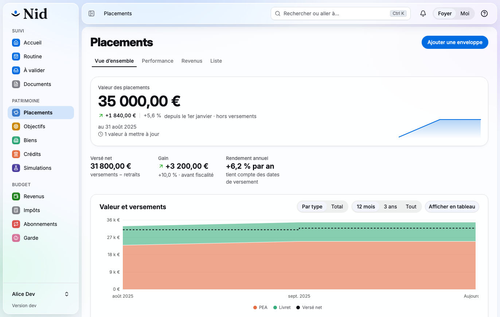 | 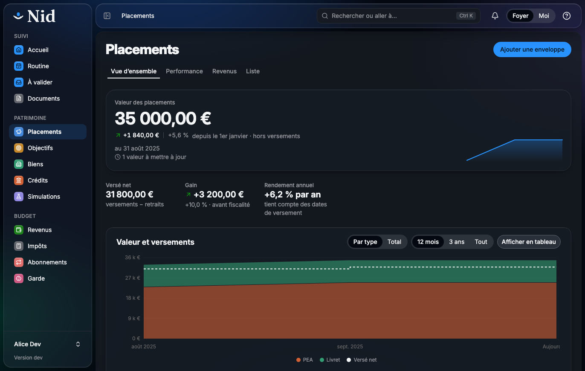 | Placements : le `Hero` (valeur, variation) avec le `StatLine` des autres chiffres dans sa carte, puis le graphique dans son `SectionCard` |
| Liste | 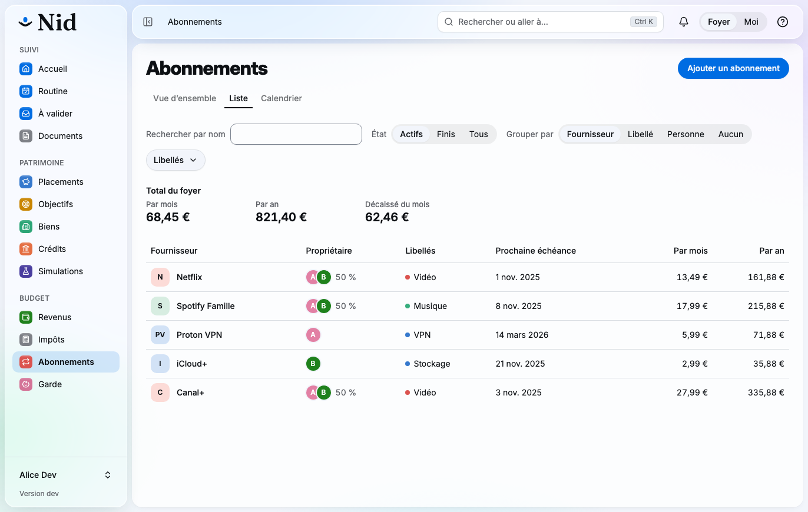 | 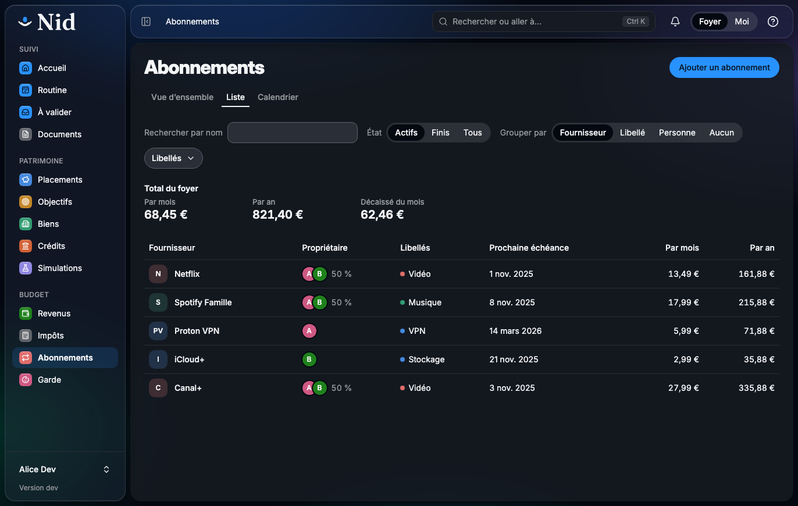 | Abonnements › Liste : la rangée de filtres de l'onglet, le total du foyer, puis le tableau dense avec ses propriétaires et ses libellés |
| Fiche | 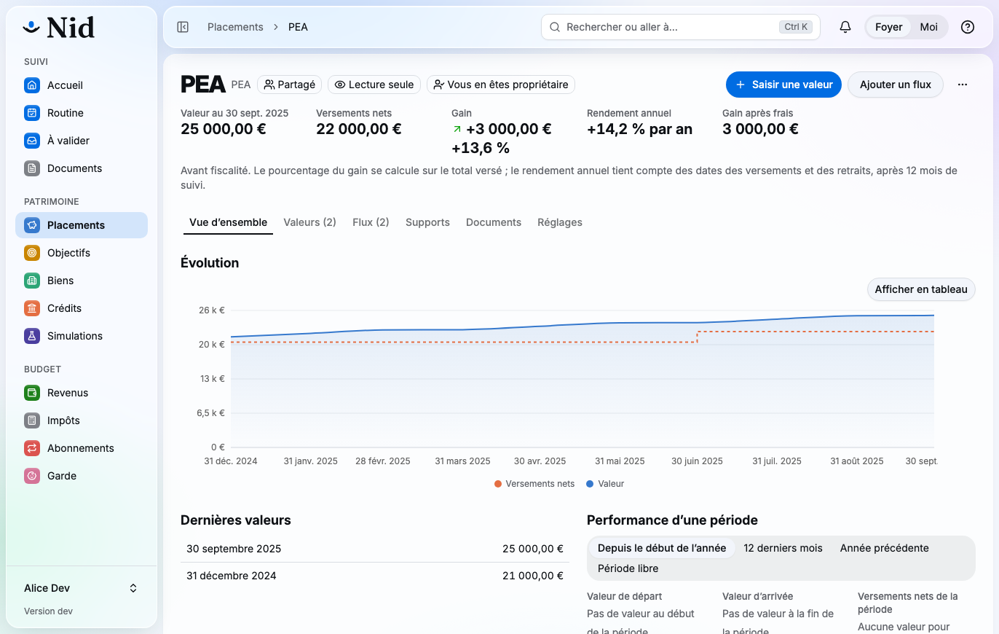 | 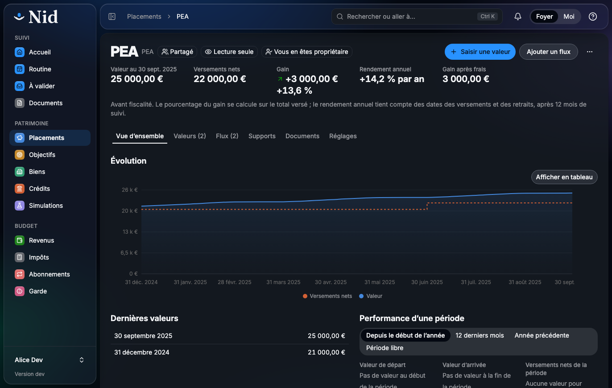 | Une enveloppe (PEA) : badges, un bouton principal, un secondaire et le `⋯` ; chiffres clés dans l'en-tête, puis les onglets |
| Formulaire | 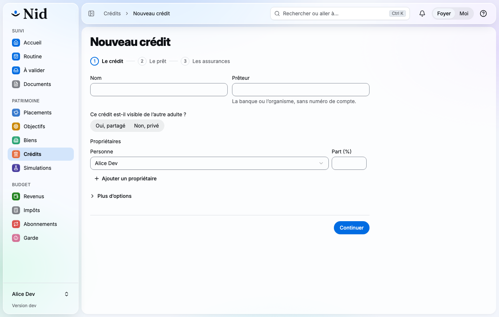 | 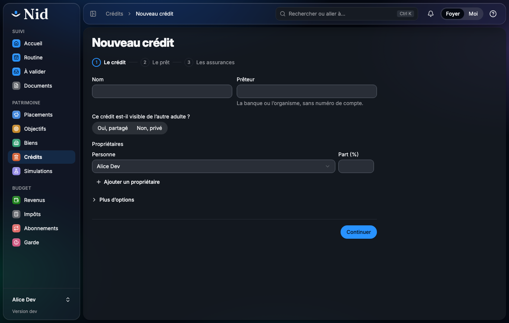 | Nouveau crédit : un `StepForm` dans `FormPage`, sans carte, l'indicateur d'étapes sous le titre et les boutons au pied |
| Réglages | 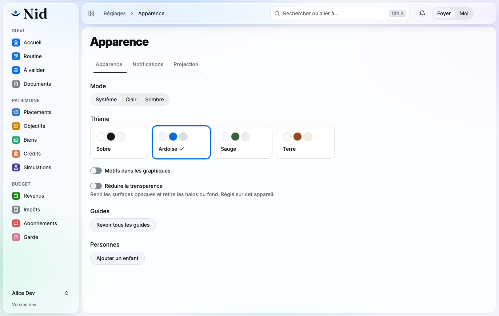 | 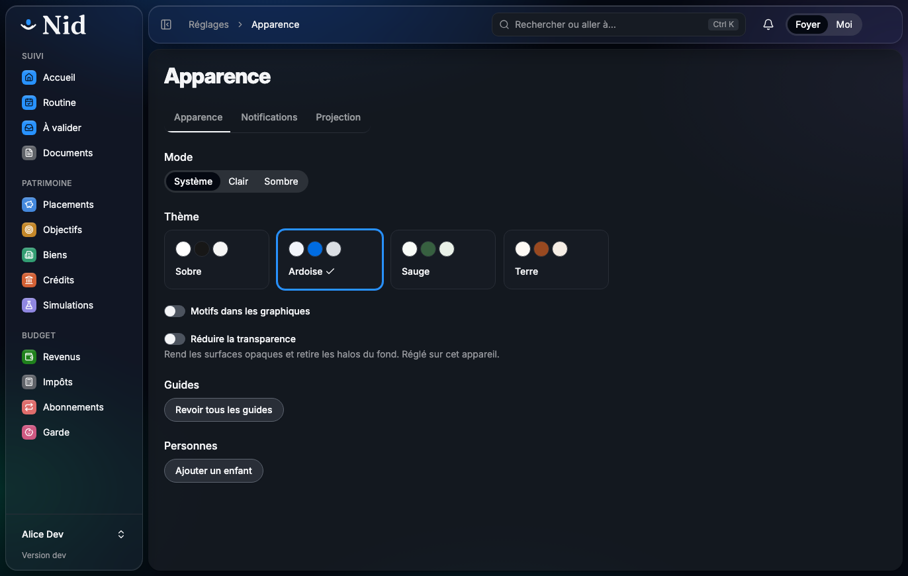 | Réglages › Apparence : le fil « Réglages › Apparence » dans la barre du haut, les onglets des réglages, mode, thème et « Réduire la transparence » |
| État vide | 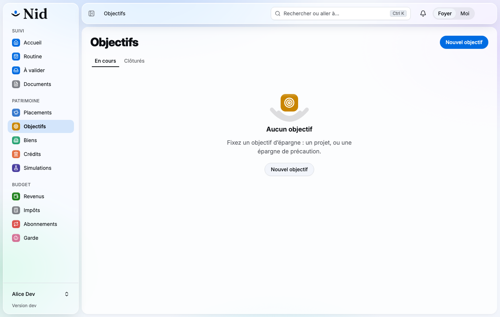 | 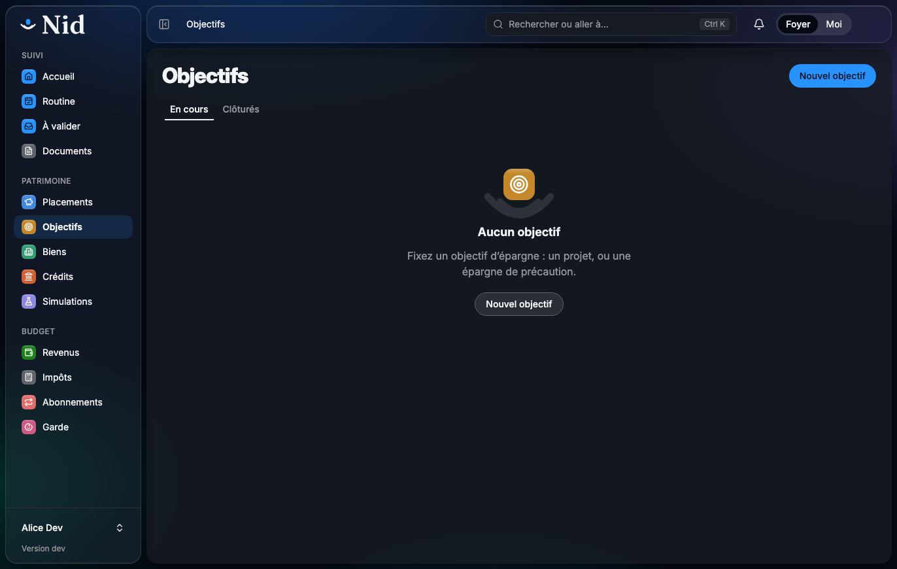 | Objectifs sans objectif : la tuile du module sur les arcs du nid, le titre, la phrase et l'action en `outline` sous le `primary` de l'en-tête |

Sur téléphone, à 390 px, en sombre : la fiche d'une enveloppe, avec le lien « ‹ Placements » dans la barre du haut, un seul bouton principal et `⋯` dans l'en-tête, et la barre d'onglets en verre en bas.

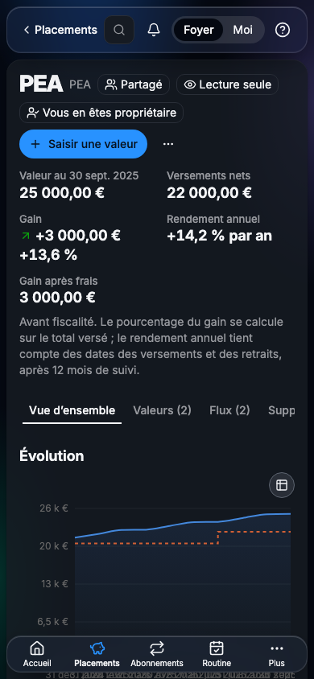
